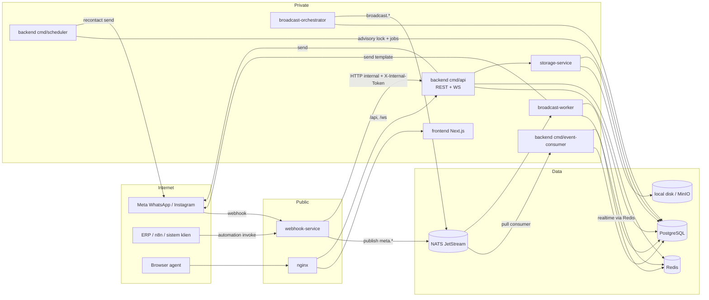
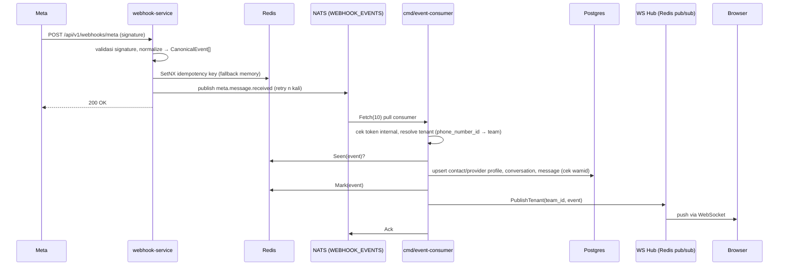
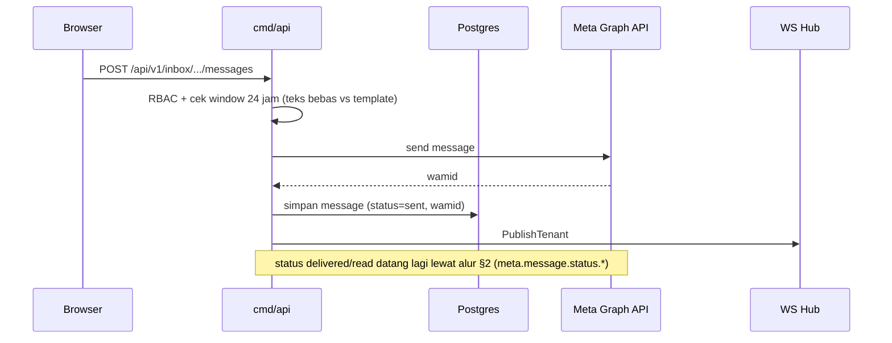
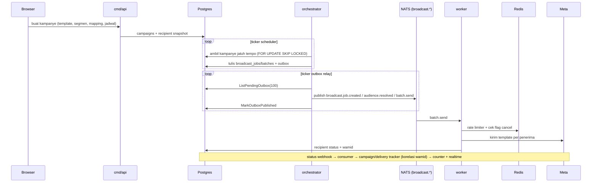
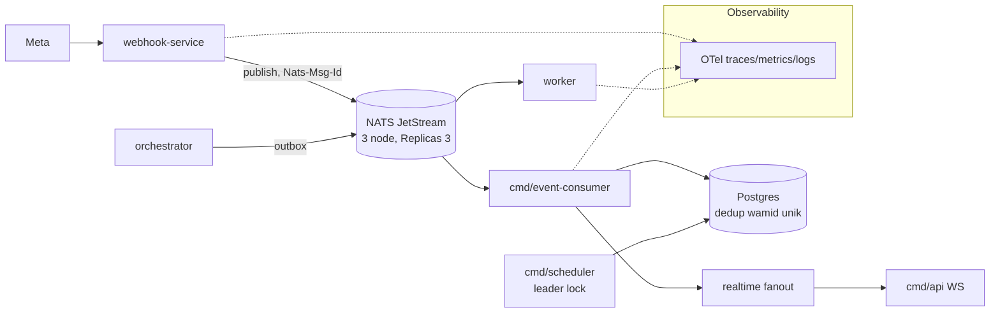

# Alur Data — Omni Chan

| | |
|---|---|
| Status | Kondisi kode per 2026-11-13 |
| Terkait | [Tech stack](tech-stack.md) · [Event subjects](../domain/events/nats-subjects.md) · [Broadcast execution](../domain/broadcast/execution-architecture.md) · [Roadmap](../roadmap/improvement-plan.md) |

## 1. Gambaran besar

**Prinsip:** hanya `webhook-service` yang menerima trafik dari Meta/klien eksternal. Backend dan storage tetap di jaringan privat.

## 2. Pesan masuk (inbound)

Kode: `services/webhook-service/internal/processor/processor.go` → `shared/nats/meta_subscriber.go` → `internal/eventconsumer/meta_handlers.go` → `internal/message/inbound.go` → `internal/websocket/hub/hub.go`.

## 3. Balasan agent (outbound dari inbox)

## 4. Broadcast / kampanye

Pola **transactional outbox** sudah dipakai di jalur ini. Pertahankan pola ini (juga bila event bus diganti kelak, lihat ADR 0009).

## 5. Alur lain

| Alur | Jalur | Catatan |
|---|---|---|
| Automation invoke | Klien → `webhook-service POST /api/v1/automation/endpoints/:id` → HTTP internal ke backend → Meta | Sinkron, timeout 60 detik |
| Forward pesan masuk | consumer `message.received` → `internal/automation` → POST ke URL klien | – |
| Media Instagram | backend membuat token media → Meta GET `/media/{token}` di webhook-service → backend → storage → stream balik | Tidak lewat NATS karena Meta butuh respons HTTP langsung (lihat [overview](overview.md)) |
| Upload file | Browser → backend `storageproxy` → storage-service → disk/MinIO | – |
| Window recontact | ticker di `cmd/scheduler` (advisory lock) → `ListDueWindowRecontacts` → klaim ledger (`INSERT … ON CONFLICT DO NOTHING`) → kirim | Satu replika per tick; klaim UNIQUE tetap menjamin satu kiriman per pesan pelanggan |
| Rekonsiliasi kampanye | ticker 24 jam di `cmd/scheduler` (advisory lock) | Satu replika pada satu waktu |
| Template sync | API/job → Meta → `templates` | Lihat [`domain/meta/template-sync-strategy.md`](../domain/meta/template-sync-strategy.md) |

## 6. Risiko per alur

| # | Risiko | Lokasi | Dampak | Fase roadmap |
|---|---|---|---|---|
| D1 | ~~Window recontact tanpa klaim~~ **Tidak valid**: sudah ada ledger UNIQUE `(conversation_id, customer_message_at)`; dikunci test `window_recontact_service_test.go`. Sisa: jika Meta menerima tapi respons timeout, klaim dilepas dan bisa terkirim ulang | `internal/inbox/window_recontact.go` | Rendah | 6 (idempotency key ke Meta) |
| D2 ✅ | Stream `WEBHOOK_EVENTS` tanpa `MaxAge`/`MaxBytes` (diperbaiki: MaxAge default 7 hari) | `webhook-service/internal/publisher/nats.go` | Disk NATS tumbuh tanpa batas | 0 |
| D3 ✅ | Consumer: `Nak()` tanpa delay; subscriber legacy tanpa batas (diperbaiki: backoff + MaxDeliver) | `shared/nats/*subscriber.go` | Poison message berputar terus, CPU/log banjir | 0 |
| D4 ✅ | Token internal salah → `Nak` tanpa batas (diperbaiki: dibatasi lalu `Term`) | `shared/nats/subscriber.go` | Redelivery tak berujung | 0 |
| D5 ✅ | `ensureStream` tidak update config / error sementara dianggap stream hilang (diperbaiki: `EnsureStream`) | `publisher/nats.go` | Perubahan konfigurasi tidak pernah diterapkan | 0 |
| D6 ✅ | Tidak ada `Nats-Msg-Id` (diperbaiki) | publisher | Dedup server-side JetStream tidak aktif | 0 |
| D7 ✅ | Partisi hanya DEFAULT; unique `(wamid, created_at)` tidak mencegah wamid ganda (diperbaiki: `message_wamids`, ADR 0008) | migrasi `000015`, `000012` | Dedup bergantung pada check-then-insert + Redis 24 jam | 6 |
| D8 ✅ | Idempotensi fallback ke memory bila Redis tak dikonfigurasi (diperbaiki: `processed_events` di Postgres + Redis cache) | `internal/app/app.go` | Duplikat setelah restart / antar replika | 6 |
| D9 ✅ | Fanout WS via Redis pub/sub bersifat at-most-once (diperbaiki: klien refetch state yang tampil saat reconnect, 6.5) | `websocket/hub` | Event hilang saat reconnect; klien harus resync delta | 6 |
| D10 ✅ | Dua jalur consumer paralel (`events.>` legacy + `meta.>`) (diperbaiki: jalur legacy dihapus, 6.4) | `internal/app/app.go` | Kompleksitas, potensi proses dobel | 6 |
| D11 ✅ | `/api/v1/metrics` terbuka di service publik (diperbaiki: wajib token internal) | `webhook-service/cmd/main.go` | Kebocoran info operasional | 0 |
| D13 ✅ | Webhook di-ACK 200 + kunci idempotensi tetap tertanda walau publish gagal → pesan hilang (diperbaiki: lepas kunci + 503) | `webhook-service/internal/processor` | Tinggi | 0 |
| D14 ✅ | Error DB saat resolve tenant dianggap terminal → event masuk DLQ tanpa retry | `eventconsumer/resolver` | Tinggi | 3 |
| D15 ✅ | Throttling Meta (HTTP 400 + 130429) dianggap gagal permanen | `pkg/meta/errors.go` | Tinggi | 3 |
| D16 ✅ | Race klaim pertama cache media di Postgres → kirim media gagal | `media/cache_repository.go` | Sedang | 3 |
| D12 | Tidak ada trace id lintas hop | semua service | Debugging alur async sulit | 4 |

## 7. Target alur (setelah roadmap)

Perubahan kunci:
- ✅ `cmd/api` dipecah menjadi `api` (HTTP + WS), `event-consumer`, dan `scheduler` (job singleton dengan leader lock) — 6.3.
- Dedup final di Postgres, bukan di Redis.
- Trace context ikut di header event.
- ✅ Event bus tetap NATS JetStream ([ADR 0009](../adr/0009-event-bus.md)): cluster 3 node, stream `Replicas: 3`, event yang kedaluwarsa sebelum diproses terpantau (alert `EventsLostBeforeProcessing`). Lihat [runbook](../runbooks/nats-cluster.md).
