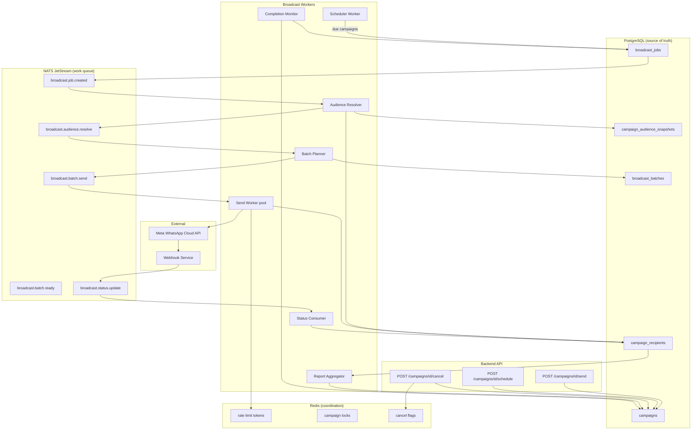
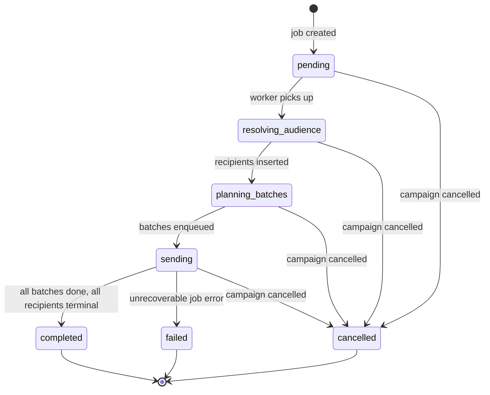
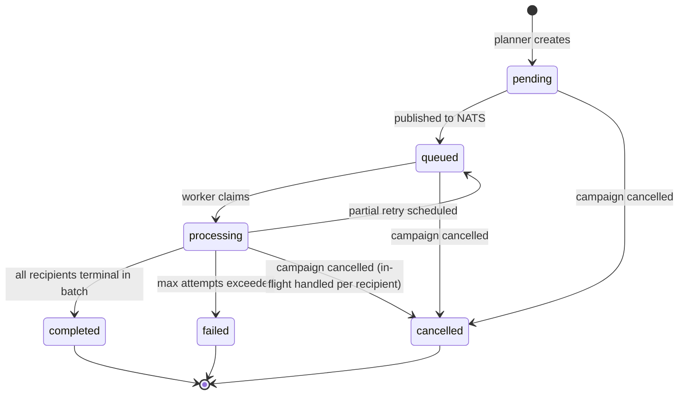
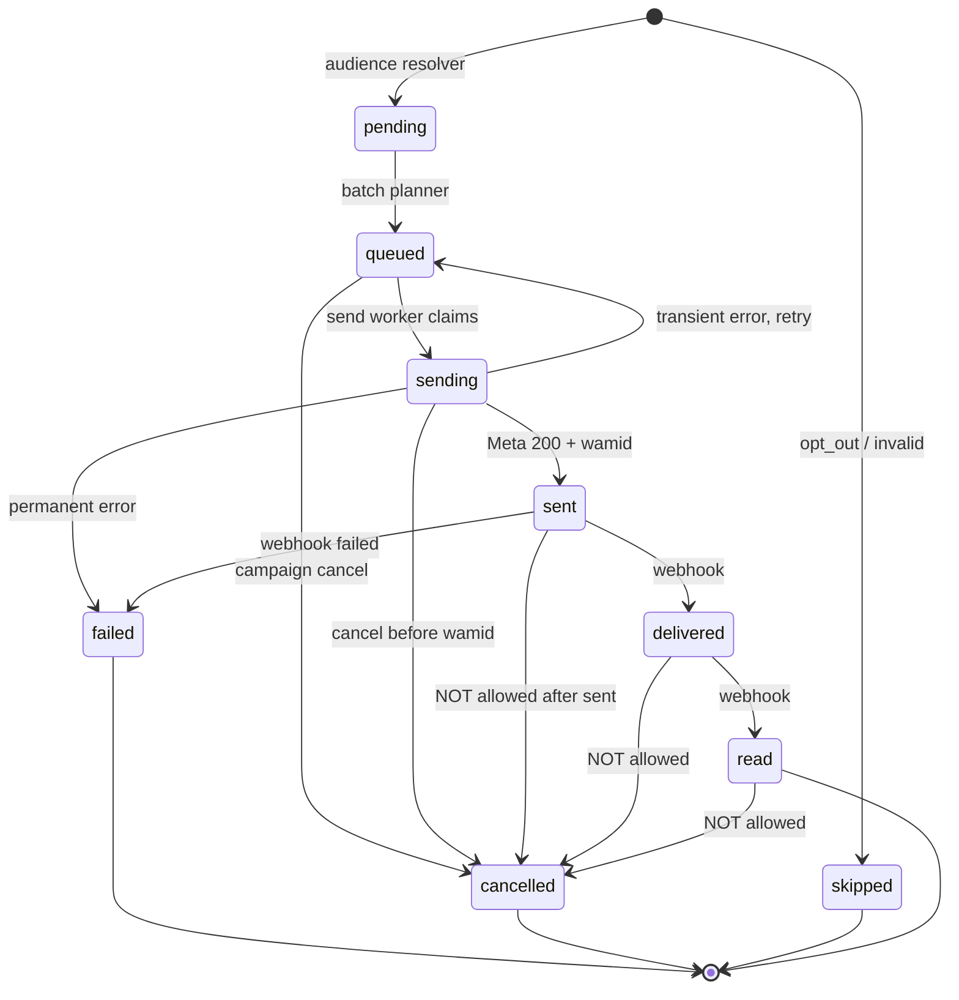

# Broadcast Execution Architecture — Omni-Chan v1

**Phase 8 — Design specification only.**  
No Go code. No SQL. No migrations.

Aligns with:
- [`docs/api-v1-contract.md`](api-v1-contract.md)
- [`docs/database-schema-v1.md`](database-schema-v1.md)
- Existing stack: **Go, PostgreSQL, Redis, NATS JetStream**

---

## 1. Objectives

| Requirement | Design response |
|-------------|-----------------|
| Official Broadcast (Meta Templates only) | Send worker calls WhatsApp Cloud API template endpoint per recipient |
| Scheduling | Scheduler worker + `campaigns.scheduled_at` |
| Rate limiting | Redis token bucket per `channel_id` / WABA |
| Retries | Batch-level + recipient-level with classified failures |
| Reporting | `campaign_recipients` as source of truth; denormalized counters on `campaigns` |
| Scale | 50k / 300k contacts per workspace; millions of recipients globally |

**Hard rule (from product policy):** API `POST /campaigns/{id}/send` MUST NOT call Meta synchronously. Execution is always async.

---

## 2. Architecture diagram



### 2.1 End-to-end flow

```
Campaign (draft|scheduled)
  → Audience Snapshot (frozen audience definition + counts)
  → Recipients Created (campaign_recipients, status=pending)
  → Broadcast Job (broadcast_jobs, 1 per execution)
  → Batches (broadcast_batches, chunks for parallel workers)
  → Messages (Meta API, wamid stored on recipient)
  → Reports (status webhooks + counter aggregation)
```

---

## 3. Queue architecture evaluation

| Option | Role in Omni-Chan | Verdict |
|--------|-------------------|---------|
| **NATS JetStream** | Durable work distribution: audience resolve, batch send, status fan-in | **Primary execution queue** |
| **Redis** | Rate limits, distributed locks, cancel flags, short-lived dedupe | **Coordination layer** |
| **PostgreSQL queue** | Scheduler poll (`campaigns` due), idempotent job creation, SKIP LOCKED batch claim fallback | **Scheduling + recovery backstop** |

### 3.1 Why not Redis-only?

Legacy worker used Redis (per `docs/tasks.md`). At millions of recipients:

- Redis lists/streams lack JetStream replay, ack semantics, and consumer scaling patterns already used for webhooks.
- Durability across worker restarts is weaker without AOF tuning and careful design.

**Migration path:** keep Redis for rate limiting; move send orchestration to NATS.

### 3.2 Why not Postgres-only?

- `SELECT … FOR UPDATE SKIP LOCKED` on `broadcast_batches` works as a fallback claim mechanism.
- Polling millions of rows does not scale for hot send paths.
- Postgres remains authoritative for state; not the hot message bus.

### 3.3 NATS JetStream streams (proposed)

| Stream | Subject(s) | Purpose | Retention |
|--------|------------|---------|-----------|
| `BROADCAST` | `broadcast.job.created` | Start audience resolution | 7 days |
| `BROADCAST` | `broadcast.audience.resolved` | Trigger batch planning | 7 days |
| `BROADCAST` | `broadcast.batch.send` | Send worker input | 7 days |
| `BROADCAST` | `broadcast.batch.retry` | Delayed retry (NAK + backoff) | 7 days |
| `BROADCAST` | `broadcast.job.completed` | Completion monitor | 7 days |
| `WHATSAPP` (existing) | `events.whatsapp.message.status` | Delivery/read/failed webhooks | per webhook doc |

**Consumer groups:** `broadcast-send-workers` (horizontally scaled), `broadcast-orchestrator` (single leader per job phase with Redis lock).

---

## 4. Database responsibilities

### 4.1 Existing tables (from Phase 7.5)

| Table | Role in execution |
|-------|-------------------|
| `campaigns` | Campaign lifecycle, schedule, denormalized counters |
| `campaign_audiences` | Audience source refs (segment, tag, contact) |
| `campaign_recipients` | Per-contact delivery ledger (**recipient lifecycle**) |
| `contacts` | Resolved at snapshot; opt_out → skipped |
| `templates` | Template payload for Meta API |
| `channels` + `channel_credentials` | WABA credentials for send |

### 4.2 Proposed execution tables

#### `broadcast_jobs`

One row per campaign **execution attempt** (initial send or resume after partial failure).

| Column | Purpose |
|--------|---------|
| id | UUID PK |
| campaign_id | FK |
| team_id | FK denormalized |
| channel_id | FK denormalized |
| status | `pending`, `resolving_audience`, `planning_batches`, `sending`, `completed`, `failed`, `cancelled` |
| total_recipients | frozen count at job start |
| batches_total | planned batch count |
| batches_completed | progress |
| recipients_sent | progress mirror |
| started_at | |
| completed_at | |
| cancelled_at | |
| cancel_reason | |
| error_summary | job-level fatal error |
| created_at | |

**Relationship:** `campaigns` 1:N `broadcast_jobs` (typically 1 active; retries create new job or resume same job — see §8).

#### `broadcast_batches`

Logical send chunks. Meta Cloud API sends **one template message per recipient**; batches group recipients for worker parallelism and retry units.

| Column | Purpose |
|--------|---------|
| id | UUID PK |
| job_id | FK → broadcast_jobs |
| campaign_id | FK denormalized |
| batch_number | sequential 1..N |
| status | `pending`, `queued`, `processing`, `completed`, `failed`, `cancelled` |
| recipient_count | |
| recipients_sent | |
| recipients_failed | |
| attempt_count | retry counter |
| next_retry_at | delayed retry scheduling |
| locked_by | worker instance id |
| locked_at | lease expiry for stale recovery |
| error_summary | |
| created_at | |
| updated_at | |

**Batch size default:** 100 recipients (tunable 50–250).  
**Max in-flight batches per channel:** governed by Redis rate limiter.

#### `campaign_audience_snapshots`

Frozen audience at send time (prevents drift if segment changes mid-send).

| Column | Purpose |
|--------|---------|
| id | UUID PK |
| campaign_id | FK |
| job_id | FK → broadcast_jobs |
| snapshot_at | TIMESTAMPTZ |
| source_summary | JSONB: `{ segments: [], tags: [], contact_ids: [] }` |
| resolved_count | after dedupe |
| skipped_opt_out | count |
| skipped_invalid | count |

#### `broadcast_batch_recipients` (junction)

Links batch to recipient rows for idempotent processing.

| Column | Purpose |
|--------|---------|
| batch_id | FK |
| recipient_id | FK → campaign_recipients |
| PRIMARY KEY | (batch_id, recipient_id) |

**Alternative:** store `batch_id` on `campaign_recipients` (nullable). Junction table keeps recipient table narrower; **recommended: `batch_id` column on `campaign_recipients`** to simplify worker queries.

**Proposed addition to `campaign_recipients`:**

| Column | Purpose |
|--------|---------|
| job_id | FK → broadcast_jobs |
| batch_id | FK → broadcast_batches, nullable until planned |
| attempt_count | per-recipient retries |
| next_retry_at | |

---

## 5. Worker responsibilities

| Worker | Trigger | Responsibility |
|--------|---------|----------------|
| **Scheduler** | Cron / Postgres poll every 30s | Find `campaigns` where `status=scheduled` AND `scheduled_at <= now()` → create `broadcast_job` → publish `broadcast.job.created` |
| **Audience Resolver** | `broadcast.job.created` | Resolve `campaign_audiences` → dedupe by phone → insert `campaign_recipients` (pending) → write `campaign_audience_snapshots` → set `campaigns.total_contacts` → transition job → publish `broadcast.audience.resolved` |
| **Batch Planner** | `broadcast.audience.resolved` | Chunk recipients into `broadcast_batches` → assign `batch_id` on recipients → enqueue `broadcast.batch.send` per batch → set campaign `queued` → job `sending` |
| **Send Worker** (pool) | `broadcast.batch.send` | Acquire rate limit token → for each recipient: pending→queued→sending → Meta API → sent/failed → ack batch |
| **Status Consumer** | `events.whatsapp.message.status` | Match `wamid` → recipient delivered/read/failed → idempotent transition |
| **Completion Monitor** | Periodic + `broadcast.batch.completed` | When all batches terminal AND all recipients terminal → campaign `completed`/`failed` → job `completed` |
| **Report Aggregator** | Recipient status change events | Increment/decrement `campaigns.*_count` atomically |
| **Stale Batch Recovery** | Cron every 5 min | Reclaim batches where `locked_at` expired → requeue |

**Deployment:** workers run as separate Go processes (`cmd/broadcast-worker`) or dedicated pods; share PostgreSQL + NATS + Redis.

---

## 6. Job lifecycle

### 6.1 Campaign → Job mapping

| Campaign action | Campaign status | Job created |
|-----------------|-----------------|-------------|
| `POST /send` | draft → queued | yes, immediately |
| Scheduler fires | scheduled → queued | yes |
| Resume after partial failure | sending (stuck) | reuse job OR new job with `attempt+1` |
| `POST /cancel` | → cancelled | job → cancelled |

### 6.2 Broadcast job state machine



### 6.3 Batch state machine



---

## 7. Recipient lifecycle

### 7.1 States (canonical)

| State | Meaning |
|-------|---------|
| `pending` | Row created; not yet assigned to a batch |
| `queued` | Assigned to batch; waiting for send worker |
| `sending` | Meta API request in flight |
| `sent` | Meta accepted message (`wamid` assigned) |
| `delivered` | Delivery webhook received |
| `read` | Read webhook received |
| `failed` | Permanent failure or retries exhausted |
| `cancelled` | Campaign cancelled before successful send |
| `skipped` | opt_out, invalid phone, duplicate — excluded from send |

**Note:** Phase 7.5 schema listed `skipped` but not `sending`/`cancelled`. Phase 8 extends recipient status enum to match execution needs.

### 7.2 Recipient state machine



**Terminal states:** `read`, `delivered` (if read not expected), `failed`, `cancelled`, `skipped`.  
For reporting funnel: `sent` ⊂ `delivered` ⊂ `read` — counters track highest achieved milestone per recipient (no double-count across sent/delivered/read).

---

## 8. Retry strategy

### 8.1 Failure classification

| Class | Examples | Action |
|-------|----------|--------|
| **Transient** | Network timeout, TCP reset, Meta 5xx, 429 rate limit | Retry with backoff |
| **Rate limit** | HTTP 429, error code 130429 | Defer batch; Redis token bucket refill |
| **Permanent** | Invalid phone (131026), template paused, user not on WhatsApp, 400 policy | `failed`, no retry |
| **Auth** | Token expired (190) | Pause job; refresh channel credential; retry once |
| **Cancelled** | User cancelled campaign | `cancelled`, no retry |

### 8.2 Retry rules

| Level | Max attempts | Backoff |
|-------|--------------|---------|
| Recipient (transient) | 3 | 30s → 2m → 10m |
| Batch (worker crash) | 5 | NATS NAK redelivery: 1m → 5m → 15m → 30m → 60m |
| Job (audience resolve failure) | 2 | 5m → 30m, then `campaign.failed` |

**Idempotency:** before Meta API call, check recipient not already `sent`. Use `wamid` uniqueness index to prevent duplicate webhook processing.

### 8.3 Rate limiting

| Scope | Limit source | Implementation |
|-------|--------------|----------------|
| Per WABA | Meta tier (e.g. 80–1000 mps) | Redis token bucket key `rate:channel:{channel_id}` |
| Per workspace | Fairness cap | Secondary bucket `rate:team:{team_id}` |
| Global workers | Worker pool size | K8s HPA on NATS consumer lag |

On 429: decrement token, set `next_retry_at` on batch, publish to `broadcast.batch.retry` with delay header.

**Official Broadcast constraint:** only **approved templates**; marketing messages require opt-in contacts (`consent_status=opt_in` or unknown per policy config).

---

## 9. Cancellation behavior

Triggered by `POST /api/v1/campaigns/{id}/cancel`.

| Recipient state | Behavior |
|-----------------|----------|
| `pending` | → `cancelled` |
| `queued` | → `cancelled` |
| `sending` (no wamid yet) | → `cancelled` if API not completed |
| `sending` (wamid received) | → `sent` (cannot recall) |
| `sent` / `delivered` / `read` | **No change** — message already with Meta |
| `failed` / `skipped` | **No change** |

| Batch state | Behavior |
|-------------|----------|
| `pending` / `queued` | → `cancelled` |
| `processing` | Worker checks Redis cancel flag `cancel:campaign:{id}` between recipients |
| `completed` | unchanged |

| Campaign | → `cancelled` |
| Job | → `cancelled`, `cancelled_at` set |

Redis `cancel:campaign:{id}` TTL = 24h. Workers poll flag at batch start and between sends.

---

## 10. Reporting

### 10.1 Counter update model

`campaigns` denormalized counters:

| Counter | Increment when |
|---------|----------------|
| `sent_count` | recipient `pending|queued|sending` → `sent` |
| `delivered_count` | `sent` → `delivered` (or direct delivered webhook) |
| `read_count` | `delivered` → `read` (or `sent` → `read`) |
| `failed_count` | any non-terminal → `failed` |
| `total_contacts` | set at audience snapshot (excludes skipped) |

**Implementation:** Report Aggregator consumes internal event `broadcast.recipient.status_changed` with `{ campaign_id, old_status, new_status }` and applies **delta rules** in a single SQL `UPDATE campaigns SET sent_count = sent_count + $1, …`.

### 10.2 Idempotent transitions

Only count when `old_status` not already counted at target level:

```
sent_count:     count recipients where status IN (sent, delivered, read)
delivered_count: count where status IN (delivered, read)
read_count:     count where status = read
failed_count:   count where status = failed
```

**Reconciliation job (nightly):** `SELECT status, COUNT(*) FROM campaign_recipients WHERE campaign_id = $1 GROUP BY status` → fix drift on `campaigns`.

### 10.3 Webhook → recipient mapping

```
events.whatsapp.message.status
  → lookup campaign_recipients by wamid
  → map Meta status: sent/delivered/read/failed
  → publish broadcast.recipient.status_changed
  → Status Consumer updates row + timestamps (delivered_at, read_at, failed_at)
```

### 10.4 Realtime UI

On counter change: Redis PubSub `campaign:{id}:stats` → WebSocket hub → dashboard live updates.

---

## 11. Scheduling

| Component | Mechanism |
|-----------|-----------|
| Store schedule | `campaigns.scheduled_at` + `campaigns.timezone` |
| Poll | Scheduler worker queries `status=scheduled AND scheduled_at <= NOW()` with `FOR UPDATE SKIP LOCKED` |
| Fire | Create `broadcast_job`, set campaign `queued`, publish NATS |
| Missed schedule | If worker down, next poll picks up overdue rows (no separate cron table in v1) |
| Duplicate guard | Unique partial index: one active job per campaign (`status NOT IN (completed, failed, cancelled)`) |

---

## 12. Scale projections

| Tier | Contacts / campaign | Recipients rows | Batches (size 100) | NATS messages |
|------|---------------------|-----------------|--------------------|---------------|
| Included | 50,000 | 50,000 | 500 | ~500 send + orchestration |
| Upgraded | 300,000 | 300,000 | 3,000 | ~3,000 send |
| Platform total | millions | partitioned `campaign_recipients` | horizontal workers | JetStream handles 10M+/day with partitioning |

**Audience resolver:** stream contacts from `segment_members` / `contact_tags` with cursor pagination (5k rows/chunk).  
**Insert recipients:** `COPY` or multi-row INSERT in 5k chunks.  
**Send workers:** scale to consumer lag; target 50–100 concurrent workers platform-wide.

---

## 13. Responsibility matrix

| Concern | PostgreSQL | NATS JetStream | Redis | Workers |
|---------|------------|----------------|-------|---------|
| Campaign/recipient truth | ✓ primary | | | read/write |
| Work distribution | fallback claim | ✓ primary | | consume |
| Rate limiting | | | ✓ | check before send |
| Cancel signal | status columns | | ✓ fast flag | poll |
| Schedule | ✓ scheduled_at | | | poll |
| Reporting counters | ✓ campaigns | event trigger | pubsub | aggregate |
| Meta credentials | ✓ encrypted | | cache optional | read |
| Webhook status | ✓ wamid lookup | ✓ ingest | | consume |

---

## 14. Internal events (NATS subjects)

| Subject | Payload | Publisher | Consumer |
|---------|---------|-----------|----------|
| `broadcast.job.created` | `{ job_id, campaign_id }` | API / Scheduler | Audience Resolver |
| `broadcast.audience.resolved` | `{ job_id, recipient_count }` | Audience Resolver | Batch Planner |
| `broadcast.batch.send` | `{ batch_id, job_id, campaign_id, channel_id }` | Batch Planner | Send Worker |
| `broadcast.batch.retry` | `{ batch_id, attempt, delay_ms }` | Send Worker | Send Worker (delayed) |
| `broadcast.recipient.status_changed` | `{ recipient_id, campaign_id, from, to }` | Send Worker, Status Consumer | Report Aggregator |
| `broadcast.job.completed` | `{ job_id, campaign_id }` | Completion Monitor | optional analytics |

---

## 15. Meta API send contract (worker)

Per recipient in batch:

1. Load template components + resolve variables from `variable_mapping` → contact fields.
2. Build Cloud API payload: `messaging_product=whatsapp`, `type=template`, `template.name`, `template.language`, `components[]`.
3. POST `/{phone_number_id}/messages`.
4. On 200: store `wamid` in `campaign_recipients`, status → `sent`, `sent_at=now`.
5. On error: classify → retry or `failed` with `failure_code`, `failure_reason`.

**No free-text broadcast.** Template must be `APPROVED` at job start (validated in API and re-checked in Send Worker).

---

## 16. Failure handling summary

| Scenario | System response |
|----------|-----------------|
| Audience resolve OOM / timeout | Job `failed`, campaign `failed`, API message |
| Partial batch failure | Batch retries; successful recipients stay `sent` |
| Channel disconnected mid-send | Pause job, campaign stays `sending`, alert ops |
| Template rejected mid-send | Remaining recipients → `failed` (template_paused) |
| Worker crash mid-batch | Stale lock recovery requeues batch; idempotent send |
| Webhook delay | Recipients stay `sent`; counters reconcile on webhook or nightly job |
| Duplicate webhook | `wamid` unique index ignores duplicate |

---

## 17. Alternatives considered

| Alternative | Why not primary |
|-------------|-----------------|
| `broadcast_jobs` only, no batches | Poor parallelism; single worker bottleneck at 300k |
| Redis queue for send | Already used in v1 legacy; weaker durability/replay vs NATS |
| Postgres SKIP LOCKED only | Acceptable for scheduler; insufficient for millions of send ops |
| One job row per recipient | 300k NATS messages per campaign with heavy PG churn; batching is required |
| Synchronous counter triggers in PG | Hot row on `campaigns` under high webhook rate; delta aggregator preferred |

---

## 18. Migration from legacy Redis worker

Per `docs/tasks.md`, existing implementation uses Redis async queue.

| Step | Action |
|------|--------|
| 1 | Introduce `broadcast_jobs` + `broadcast_batches` alongside existing flow |
| 2 | Dual-publish: Redis (legacy) + NATS (new) behind feature flag |
| 3 | Migrate send worker to NATS consumer |
| 4 | Move rate limiting to Redis token bucket (may already exist) |
| 5 | Wire webhook status → `campaign_recipients` (deferred task) |
| 6 | Remove Redis send queue |

---

## 19. Open decisions (for review)

| # | Decision | Recommendation |
|---|----------|----------------|
| 1 | `batch_id` on `campaign_recipients` vs junction table | Column on recipients (simpler queries) |
| 2 | New job per resume vs resume same job | Same job with `attempt_count` unless corruption |
| 3 | `skipped` vs `cancelled` for opt_out at snapshot | `skipped` (excluded from total_contacts) |
| 4 | Marketing consent: require `opt_in` only | Config per workspace (`teams` policy flag) |
| 5 | Batch size default | 100 recipients |

---

*End of Phase 8 broadcast execution architecture — awaiting review before implementation.*
