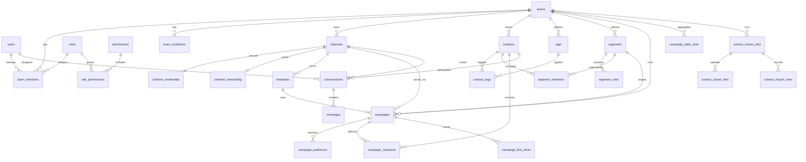

# PostgreSQL Schema Design — Omni-Chan v1

**Phase 7.5 — Design specification only.**  
No SQL. No migrations. Aligns with [`docs/api-v1-contract.md`](api-v1-contract.md).

---

## 1. Design principles

| Principle | Rule |
|-----------|------|
| Tenant isolation | Every business row scoped by `team_id` (workspace) |
| Primary keys | UUID v4 (`gen_random_uuid()`) |
| Timestamps | `created_at`, `updated_at` (TIMESTAMPTZ UTC) on all mutable entities |
| Soft delete | `deleted_at` on user-managed entities; hard delete on immutable logs |
| API naming | DB table `channels` is canonical; legacy code may still say `devices` |
| Secrets | Channel tokens in separate encrypted table, never in API DTO |
| Scale targets | 50k contacts (included), 300k contacts (upgraded), millions of campaign recipients |

**Existing tables (already migrated):** `teams`, `users`, `team_members`, `roles`, `permissions`, `role_permissions`, `team_invitations`, `refresh_tokens` (implied by auth module).

---

## 2. Entity list

| Entity | Table | Scope | Soft delete |
|--------|-------|-------|-------------|
| Workspace | `teams` | global | yes |
| User | `users` | global | yes |
| Team membership | `team_members` | team | yes |
| Team invitation | `team_invitations` | team | yes |
| Role | `roles` | global (system) | yes |
| Permission | `permissions` | global | no |
| Role permission | `role_permissions` | global | no |
| Refresh token | `refresh_tokens` | user | no (revoke) |
| Channel | `channels` | team | yes |
| Channel credential | `channel_credentials` | channel | no |
| Channel onboarding | `channel_onboarding` | channel | no |
| Template | `templates` | channel | yes |
| Campaign | `campaigns` | team | yes |
| Campaign audience link | `campaign_audiences` | campaign | no |
| Campaign recipient | `campaign_recipients` | campaign | no |
| Campaign link click | `campaign_link_clicks` | campaign | no |
| Campaign daily stats | `campaign_daily_stats` | team | no |
| Contact | `contacts` | team | yes |
| Tag | `tags` | team | yes |
| Contact tag | `contact_tags` | contact | no |
| Segment | `segments` | team | yes |
| Segment rule | `segment_rules` | segment | no |
| Segment member | `segment_members` | segment | no |
| Conversation | `conversations` | team | yes |
| Message | `messages` | conversation | no |
| Contact import job | `contact_import_jobs` | team | no |
| Contact import file | `contact_import_files` | job | no |
| Contact import row | `contact_import_rows` | job | no |
| Workspace readiness cache | `workspace_readiness_snapshots` | team | no (optional) |

---

## 3. ERD



---

## 4. Table inventory

### 4.1 Workspace & auth (existing + extensions)

#### `teams` (Workspace)

| Column | Type | Notes |
|--------|------|-------|
| id | UUID PK | |
| name | VARCHAR(255) | |
| slug | VARCHAR(100) | unique active |
| owner_id | UUID FK → users | denormalized for workspace detail |
| timezone | VARCHAR(64) | default `Asia/Jakarta` |
| country | CHAR(2) | ISO country |
| plan_tier | VARCHAR(32) | `included`, `upgraded`, `enterprise` |
| contact_limit | INTEGER | 50_000 / 300_000 |
| created_at | TIMESTAMPTZ | |
| updated_at | TIMESTAMPTZ | |
| deleted_at | TIMESTAMPTZ | soft delete |

**Constraints:** unique `(LOWER(slug))` where `deleted_at IS NULL`

#### `users` (existing)

| Column | Type | Notes |
|--------|------|-------|
| id | UUID PK | |
| email | VARCHAR(255) | unique active |
| name | VARCHAR(255) | |
| password_hash | VARCHAR(255) | |
| last_active_at | TIMESTAMPTZ | nullable |
| created_at | TIMESTAMPTZ | |
| updated_at | TIMESTAMPTZ | |
| deleted_at | TIMESTAMPTZ | |

#### `team_members` (existing + RBAC)

| Column | Type | Notes |
|--------|------|-------|
| id | UUID PK | member record id (API `TeamMemberDTO.id`) |
| team_id | UUID FK → teams | |
| user_id | UUID FK → users | |
| role | team_role ENUM | legacy enum; kept for compat |
| role_id | UUID FK → roles | canonical RBAC |
| status | VARCHAR(20) | `active`, `inactive`, `invited` |
| created_at | TIMESTAMPTZ | |
| updated_at | TIMESTAMPTZ | |
| deleted_at | TIMESTAMPTZ | |

**Constraints:** unique `(team_id, user_id)` where `deleted_at IS NULL`

#### `roles`, `permissions`, `role_permissions`, `team_invitations`

As defined in migration `000012_rbac`. No structural change required for v1.

#### `refresh_tokens` (existing implied)

| Column | Type | Notes |
|--------|------|-------|
| id | UUID PK | |
| user_id | UUID FK | |
| team_id | UUID FK | |
| token_hash | VARCHAR(255) | |
| expires_at | TIMESTAMPTZ | |
| revoked_at | TIMESTAMPTZ | nullable |
| created_at | TIMESTAMPTZ | |

---

### 4.2 Channels

#### `channels`

Replaces legacy `devices` table name in new schema. Maps to `ChannelDTO`.

| Column | Type | Notes |
|--------|------|-------|
| id | UUID PK | |
| team_id | UUID FK → teams | workspace scope |
| name | VARCHAR(255) | API display label |
| provider | VARCHAR(32) | default `meta` |
| status | VARCHAR(20) | `disconnected`, `connecting`, `connected` |
| connection_type | VARCHAR(20) | `manual`, `embedded_coex` |
| phone_number | VARCHAR(32) | E.164, nullable |
| waba_id | VARCHAR(64) | Meta WABA |
| phone_number_id | VARCHAR(64) | Meta phone number id |
| is_coex | BOOLEAN | default false |
| last_connected_at | TIMESTAMPTZ | nullable |
| created_at | TIMESTAMPTZ | |
| updated_at | TIMESTAMPTZ | |
| deleted_at | TIMESTAMPTZ | |

**Relationships:** `teams` 1:N `channels`

**Constraints:**
- unique `(team_id, phone_number_id)` where `deleted_at IS NULL` and `phone_number_id IS NOT NULL`
- check `status` in allowed set

#### `channel_credentials`

| Column | Type | Notes |
|--------|------|-------|
| channel_id | UUID PK FK → channels | 1:1 |
| access_token_enc | BYTEA | encrypted at rest |
| token_expires_at | TIMESTAMPTZ | nullable |
| updated_at | TIMESTAMPTZ | |

Never exposed via API.

#### `channel_onboarding`

| Column | Type | Notes |
|--------|------|-------|
| channel_id | UUID PK FK → channels | 1:1 |
| status | VARCHAR(32) | coex onboarding enum |
| contacts_synced_count | INTEGER | default 0 |
| history_messages_synced | INTEGER | default 0 |
| history_sync_progress | SMALLINT | 0–100 |
| error_message | TEXT | nullable |
| completed_at | TIMESTAMPTZ | nullable |
| updated_at | TIMESTAMPTZ | |

---

### 4.3 Templates

#### `templates`

| Column | Type | Notes |
|--------|------|-------|
| id | UUID PK | |
| channel_id | UUID FK → channels | |
| team_id | UUID FK → teams | denormalized for tenant queries |
| waba_id | VARCHAR(64) | |
| meta_template_id | VARCHAR(128) | Meta-side id |
| name | VARCHAR(512) | |
| language | VARCHAR(16) | e.g. `id_ID` |
| category | VARCHAR(32) | MARKETING, UTILITY, AUTHENTICATION |
| status | VARCHAR(16) | APPROVED, PENDING, REJECTED |
| preview | TEXT | nullable |
| components | JSONB | Meta component array |
| variable_count | SMALLINT | derived |
| last_sync_at | TIMESTAMPTZ | nullable |
| created_at | TIMESTAMPTZ | |
| updated_at | TIMESTAMPTZ | |
| deleted_at | TIMESTAMPTZ | |

**Relationships:** `channels` 1:N `templates`

**Constraints:**
- unique `(channel_id, meta_template_id)` where `deleted_at IS NULL`
- unique `(channel_id, name, language)` where `deleted_at IS NULL`

---

### 4.4 Campaigns

#### `campaigns`

| Column | Type | Notes |
|--------|------|-------|
| id | UUID PK | |
| team_id | UUID FK → teams | |
| channel_id | UUID FK → channels | |
| template_id | UUID FK → templates | |
| segment_id | UUID FK → segments | nullable; primary segment |
| name | VARCHAR(255) | |
| description | TEXT | nullable |
| status | VARCHAR(20) | draft, scheduled, queued, sending, completed, failed, cancelled |
| variable_mapping | JSONB | `{ "body": { "1": "name" } }` |
| sample_values | JSONB | nullable |
| timezone | VARCHAR(64) | nullable |
| send_mode | VARCHAR(8) | `now`, `later` |
| scheduled_at | TIMESTAMPTZ | nullable |
| started_at | TIMESTAMPTZ | nullable |
| completed_at | TIMESTAMPTZ | nullable |
| total_contacts | INTEGER | audience size at send time |
| sent_count | INTEGER | denormalized |
| delivered_count | INTEGER | denormalized |
| read_count | INTEGER | denormalized |
| failed_count | INTEGER | denormalized |
| reply_count | INTEGER | denormalized |
| clicked_count | INTEGER | denormalized |
| created_by | UUID FK → users | nullable |
| created_at | TIMESTAMPTZ | |
| updated_at | TIMESTAMPTZ | |
| deleted_at | TIMESTAMPTZ | |

**Relationships:**
- `channels` 1:N `campaigns`
- `segments` 1:N `campaigns` (optional FK)
- `templates` 1:N `campaigns`

#### `campaign_audiences`

Resolves multi-source audience at campaign creation (segments, tags, explicit contacts).

| Column | Type | Notes |
|--------|------|-------|
| id | UUID PK | |
| campaign_id | UUID FK → campaigns | |
| source_type | VARCHAR(16) | `segment`, `tag`, `contact` |
| source_id | UUID | polymorphic FK |
| created_at | TIMESTAMPTZ | |

**Constraints:** unique `(campaign_id, source_type, source_id)`

#### `campaign_recipients` ⚡ high volume

Per-contact delivery ledger. Primary reporting source.

| Column | Type | Notes |
|--------|------|-------|
| id | UUID PK | |
| campaign_id | UUID FK → campaigns | partition key |
| team_id | UUID FK → teams | denormalized |
| contact_id | UUID FK → contacts | |
| phone | VARCHAR(32) | snapshot at send |
| status | VARCHAR(20) | pending, queued, sent, delivered, read, failed, skipped |
| failure_code | VARCHAR(64) | nullable |
| failure_reason | TEXT | nullable |
| wamid | VARCHAR(128) | Meta message id |
| sent_at | TIMESTAMPTZ | nullable |
| delivered_at | TIMESTAMPTZ | nullable |
| read_at | TIMESTAMPTZ | nullable |
| failed_at | TIMESTAMPTZ | nullable |
| created_at | TIMESTAMPTZ | |

**Relationships:** `campaigns` 1:N `campaign_recipients`

**Constraints:**
- unique `(campaign_id, contact_id)`
- check `status` in allowed set

#### `campaign_link_clicks`

| Column | Type | Notes |
|--------|------|-------|
| id | UUID PK | |
| campaign_id | UUID FK | |
| recipient_id | UUID FK → campaign_recipients | nullable |
| url | TEXT | |
| clicked_at | TIMESTAMPTZ | |
| user_agent | TEXT | nullable |
| device_type | VARCHAR(16) | mobile, desktop, other |

---

### 4.5 Contacts

#### `contacts`

| Column | Type | Notes |
|--------|------|-------|
| id | UUID PK | |
| team_id | UUID FK → teams | |
| name | VARCHAR(255) | |
| phone | VARCHAR(32) | E.164 normalized |
| email | VARCHAR(255) | nullable |
| notes | TEXT | nullable |
| city | VARCHAR(128) | nullable |
| language | VARCHAR(16) | nullable |
| customer_type | VARCHAR(64) | nullable |
| source | VARCHAR(16) | whatsapp, import, manual, api |
| consent_status | VARCHAR(16) | opt_in, opt_out, unknown |
| last_activity_at | TIMESTAMPTZ | nullable |
| import_job_id | UUID FK | nullable; provenance |
| created_at | TIMESTAMPTZ | |
| updated_at | TIMESTAMPTZ | |
| deleted_at | TIMESTAMPTZ | |

**Constraints:**
- unique `(team_id, phone)` where `deleted_at IS NULL`
- check `consent_status` in allowed set

**Plan enforcement:** `COUNT(*)` per `team_id` where `deleted_at IS NULL` ≤ `teams.contact_limit`

#### `tags`

| Column | Type | Notes |
|--------|------|-------|
| id | UUID PK | |
| team_id | UUID FK | |
| name | VARCHAR(100) | |
| color | VARCHAR(16) | hex |
| description | TEXT | nullable |
| contact_count | INTEGER | denormalized cache |
| created_by | UUID FK → users | nullable |
| created_at | TIMESTAMPTZ | |
| updated_at | TIMESTAMPTZ | |
| deleted_at | TIMESTAMPTZ | |

**Constraints:** unique `(team_id, LOWER(name))` where `deleted_at IS NULL`

#### `contact_tags`

| Column | Type | Notes |
|--------|------|-------|
| contact_id | UUID FK → contacts | |
| tag_id | UUID FK → tags | |
| created_at | TIMESTAMPTZ | |

**PK:** `(contact_id, tag_id)`

#### `segments`

| Column | Type | Notes |
|--------|------|-------|
| id | UUID PK | |
| team_id | UUID FK | |
| name | VARCHAR(255) | |
| description | TEXT | |
| color | VARCHAR(16) | |
| contact_count | INTEGER | denormalized |
| is_dynamic | BOOLEAN | default true |
| last_evaluated_at | TIMESTAMPTZ | nullable |
| created_at | TIMESTAMPTZ | |
| updated_at | TIMESTAMPTZ | |
| deleted_at | TIMESTAMPTZ | |

#### `segment_rules`

| Column | Type | Notes |
|--------|------|-------|
| id | UUID PK | |
| segment_id | UUID FK → segments | |
| field | VARCHAR(32) | tag, city, last_activity, consent_status, source |
| operator | VARCHAR(16) | equals, not_equals, contains, less_than, greater_than |
| value | VARCHAR(255) | |
| sort_order | SMALLINT | rule evaluation order |
| created_at | TIMESTAMPTZ | |

#### `segment_members` (materialized)

Avoids re-evaluating rules on every campaign send at 300k scale.

| Column | Type | Notes |
|--------|------|-------|
| segment_id | UUID FK → segments | |
| contact_id | UUID FK → contacts | |
| added_at | TIMESTAMPTZ | |

**PK:** `(segment_id, contact_id)`

Rebuilt asynchronously when rules change or contacts update (NATS job).

---

### 4.6 Inbox

#### `conversations`

| Column | Type | Notes |
|--------|------|-------|
| id | UUID PK | |
| team_id | UUID FK | |
| contact_id | UUID FK → contacts | |
| channel_id | UUID FK → channels | nullable |
| channel_type | VARCHAR(16) | whatsapp, instagram, other |
| status | VARCHAR(16) | open, assigned, closed |
| assigned_to | UUID FK → users | nullable |
| unread_count | INTEGER | denormalized |
| last_message_preview | TEXT | |
| last_message_at | TIMESTAMPTZ | |
| created_at | TIMESTAMPTZ | |
| updated_at | TIMESTAMPTZ | |
| deleted_at | TIMESTAMPTZ | |

**Constraints:** unique `(team_id, contact_id, channel_id)` where `deleted_at IS NULL`

#### `messages`

| Column | Type | Notes |
|--------|------|-------|
| id | UUID PK | |
| conversation_id | UUID FK → conversations | |
| team_id | UUID FK | denormalized |
| channel_id | UUID FK | nullable |
| direction | VARCHAR(8) | inbound, outbound |
| sender | VARCHAR(64) | phone or system |
| recipient | VARCHAR(64) | nullable |
| content | TEXT | |
| content_type | VARCHAR(16) | text, image, template, etc. |
| wamid | VARCHAR(128) | nullable |
| status | VARCHAR(16) | sent, delivered, read, failed |
| received_at | TIMESTAMPTZ | |
| created_at | TIMESTAMPTZ | |

Immutable append-only log.

---

### 4.7 Import jobs

#### `contact_import_jobs`

| Column | Type | Notes |
|--------|------|-------|
| id | UUID PK | |
| team_id | UUID FK | |
| source | VARCHAR(16) | csv, excel, manual |
| status | VARCHAR(16) | pending, processing, completed, failed |
| filename | VARCHAR(512) | |
| total_rows | INTEGER | |
| imported_count | INTEGER | |
| updated_count | INTEGER | |
| skipped_count | INTEGER | |
| failed_count | INTEGER | |
| error_summary | TEXT | nullable |
| created_by | UUID FK → users | |
| started_at | TIMESTAMPTZ | nullable |
| completed_at | TIMESTAMPTZ | nullable |
| created_at | TIMESTAMPTZ | |

#### `contact_import_files`

| Column | Type | Notes |
|--------|------|-------|
| id | UUID PK | |
| job_id | UUID FK → contact_import_jobs | |
| storage_key | VARCHAR(512) | MinIO object key |
| mime_type | VARCHAR(128) | |
| size_bytes | BIGINT | |
| checksum | VARCHAR(64) | SHA-256 |
| created_at | TIMESTAMPTZ | |

#### `contact_import_rows`

Row-level results for UI error drill-down.

| Column | Type | Notes |
|--------|------|-------|
| id | UUID PK | |
| job_id | UUID FK | |
| row_number | INTEGER | 1-based |
| status | VARCHAR(16) | imported, updated, skipped, failed |
| contact_id | UUID FK | nullable if failed |
| raw_data | JSONB | original row snapshot |
| error_message | TEXT | nullable |
| created_at | TIMESTAMPTZ | |

---

### 4.8 Campaign reports

Reporting is **recipient-first**: `campaign_recipients` is the source of truth for per-contact delivery. Denormalized counters on `campaigns` power list views. Optional rollups preserve dashboard history after recipient purge.

#### `campaign_daily_stats`

Workspace-level time series for `GET /api/v1/reports/dashboard`.

| Column | Type | Notes |
|--------|------|-------|
| id | UUID PK | |
| team_id | UUID FK → teams | |
| stat_date | DATE | UTC date bucket |
| campaigns_started | INTEGER | default 0 |
| messages_sent | INTEGER | default 0 |
| messages_delivered | INTEGER | default 0 |
| messages_read | INTEGER | default 0 |
| messages_failed | INTEGER | default 0 |
| replies_received | INTEGER | default 0 |
| link_clicks | INTEGER | default 0 |
| created_at | TIMESTAMPTZ | |
| updated_at | TIMESTAMPTZ | |

**Constraints:** unique `(team_id, stat_date)`

Populated by nightly rollup job from `campaign_recipients` + `campaign_link_clicks`. Per-campaign detail (`GET /reports/campaigns/{id}`) queries `campaigns` counters + recipient status GROUP BY + `campaign_link_clicks` — no `campaign_reports` snapshot table in v1.

#### `workspace_readiness_snapshots` (optional)

| Column | Type | Notes |
|--------|------|-------|
| team_id | UUID PK FK | |
| score | SMALLINT | 0–100 |
| checks | JSONB | readiness checklist |
| computed_at | TIMESTAMPTZ | |

Refreshed on channel connect, template sync, import complete, campaign create.

**Primary reporting** is computed from:
- `campaigns` aggregate counters (dashboard KPIs)
- `campaign_recipients` (funnel, per-campaign report)
- `campaign_link_clicks` (link metrics)

No separate `campaign_reports` table in v1 — report API reads aggregates + recipient rollups.

---

## 5. Relationships summary

| Parent | Child | Cardinality | On delete |
|--------|-------|-------------|-----------|
| teams | channels | 1:N | restrict |
| teams | contacts | 1:N | restrict |
| teams | campaigns | 1:N | restrict |
| teams | segments | 1:N | restrict |
| teams | tags | 1:N | restrict |
| teams | conversations | 1:N | restrict |
| channels | templates | 1:N | cascade soft |
| channels | campaigns | 1:N | restrict |
| channels | conversations | 1:N | set null |
| segments | campaigns | 1:N | set null |
| segments | segment_rules | 1:N | cascade |
| segments | segment_members | 1:N | cascade |
| contacts | contact_tags | 1:N | cascade |
| contacts | campaign_recipients | 1:N | restrict |
| contacts | conversations | 1:N | restrict |
| campaigns | campaign_audiences | 1:N | cascade |
| campaigns | campaign_recipients | 1:N | cascade |
| campaigns | campaign_link_clicks | 1:N | cascade |
| teams | campaign_daily_stats | 1:N | cascade |
| conversations | messages | 1:N | restrict |
| contact_import_jobs | contact_import_files | 1:N | cascade |
| contact_import_jobs | contact_import_rows | 1:N | cascade |

---

## 6. Indexes

### 6.1 Workspace & team

| Table | Index | Purpose |
|-------|-------|---------|
| teams | `(LOWER(slug))` unique partial | slug lookup |
| team_members | `(team_id)` partial active | member list |
| team_members | `(user_id)` partial active | primary membership |
| team_invitations | `(team_id, email)` partial pending | dedupe invites |

### 6.2 Channels & templates

| Table | Index | Purpose |
|-------|-------|---------|
| channels | `(team_id, status)` partial active | list connected |
| channels | `(phone_number_id)` partial active | webhook routing |
| channels | `(waba_id)` | Meta sync |
| templates | `(channel_id, status)` partial active | wizard filter |
| templates | `(team_id, name)` partial active | search |
| templates | GIN `(components)` | optional JSON search |

### 6.3 Contacts (50k–300k per team)

| Table | Index | Purpose |
|-------|-------|---------|
| contacts | `(team_id, created_at DESC)` partial active | paginated list |
| contacts | `(team_id, phone)` unique partial | dedupe |
| contacts | `(team_id, consent_status)` partial active | filter |
| contacts | `(team_id, last_activity_at DESC)` partial active | segment rules |
| contacts | GIN trigram `(name, phone, email)` | `?search=` |
| contact_tags | `(tag_id)` | tag member count |
| contact_tags | `(contact_id)` | contact detail |
| tags | `(team_id, LOWER(name))` unique partial | dedupe |
| segments | `(team_id, updated_at DESC)` partial active | list |
| segment_members | `(segment_id)` | audience resolution |
| segment_members | `(contact_id)` | reverse lookup |

### 6.4 Campaigns

| Table | Index | Purpose |
|-------|-------|---------|
| campaigns | `(team_id, status, scheduled_at)` partial active | schedule calendar |
| campaigns | `(team_id, created_at DESC)` partial active | list |
| campaigns | `(channel_id)` | channel filter |
| campaigns | `(segment_id)` | segment filter |
| campaign_audiences | `(campaign_id)` | audience resolve |
| campaign_recipients | `(campaign_id, status)` | send worker batch |
| campaign_recipients | `(campaign_id, contact_id)` unique | idempotency |
| campaign_recipients | `(contact_id, created_at DESC)` | contact history |
| campaign_recipients | `(team_id, created_at DESC)` | dashboard rollups |
| campaign_link_clicks | `(campaign_id, clicked_at)` | report charts |
| campaign_daily_stats | `(team_id, stat_date DESC)` unique | dashboard trend |

### 6.5 Inbox

| Table | Index | Purpose |
|-------|-------|---------|
| conversations | `(team_id, last_message_at DESC)` partial active | inbox list |
| conversations | `(team_id, status, assigned_to)` partial active | agent queue |
| conversations | `(contact_id)` | contact drawer |
| messages | `(conversation_id, created_at)` | thread history |
| messages | `(wamid)` unique partial | webhook dedupe |
| messages | `(team_id, received_at DESC)` | recent activity |

### 6.6 Imports

| Table | Index | Purpose |
|-------|-------|---------|
| contact_import_jobs | `(team_id, created_at DESC)` | job list |
| contact_import_rows | `(job_id, status)` | error summary |
| contact_import_rows | `(job_id, row_number)` | paginated errors |

---

## 7. Soft delete strategy

| Category | Tables | Strategy |
|----------|--------|----------|
| User-managed | teams, users, team_members, channels, templates, campaigns, contacts, tags, segments, conversations | `deleted_at` set; all queries filter `deleted_at IS NULL` |
| Immutable logs | messages, campaign_recipients, campaign_link_clicks, contact_import_rows | hard delete never; retention policy archives/purges |
| Junction | contact_tags, segment_members, campaign_audiences | hard delete on parent unlink |
| Secrets | channel_credentials | hard delete on channel disconnect |
| System reference | roles, permissions | soft delete roles only; permissions permanent |

**Cascade rules:**
- Soft-deleting a contact does NOT delete `campaign_recipients` (historical integrity)
- Soft-deleting a campaign hides from UI; recipients retained for reporting
- Soft-deleting a channel blocks new campaigns; existing campaign data retained

---

## 8. Partitioning recommendations

### 8.1 `campaign_recipients` (millions+ rows)

**Recommended:** RANGE partition on `created_at` (monthly).

```
campaign_recipients_2026_06
campaign_recipients_2026_07
...
```

- Partition pruning for report date ranges
- Drop old partitions after retention window
- Alternative at extreme scale: HASH sub-partition on `campaign_id` within monthly range

**When to apply:** > 10M rows or > 50k recipients per campaign routinely.

### 8.2 `messages` (high ingest)

**Recommended:** RANGE partition on `created_at` (monthly), optionally sub-partition by `team_id` for large multi-tenant hosts.

### 8.3 `contact_import_rows`

**Recommended:** RANGE partition on `created_at` (monthly); small table but high churn.

### 8.4 Tables NOT partitioned in v1

contacts (≤300k/team), templates, campaigns, conversations — btree indexes sufficient.

---

## 9. Retention recommendations

| Data | Hot retention | Archive | Purge |
|------|---------------|---------|-------|
| messages | 12 months | MinIO cold JSON | 24 months |
| campaign_recipients | 18 months | monthly aggregate table | 24 months (keep campaign counters) |
| campaign_link_clicks | 12 months | roll into campaign stats | 18 months |
| contact_import_files | 30 days | — | delete MinIO object |
| contact_import_rows | 90 days | error summary in job row | 90 days |
| channel_credentials | until disconnect | — | immediate on disconnect |
| refresh_tokens | until expiry + 7d | — | scheduled job |
| workspace_readiness_snapshots | latest only | — | overwrite |

**Aggregate preservation:** before purging `campaign_recipients`, persist funnel totals on `campaigns` (already denormalized) and upsert `campaign_daily_stats` for dashboard history.

---

## 10. Performance notes

### 10.1 Contact limits

| Plan | Limit | Enforcement |
|------|-------|-------------|
| Included | 50,000 | check on import + create |
| Upgraded | 300,000 | check on import + create |

Use `teams.contact_limit` + transactional count; reject import job early if `total_rows` exceeds headroom.

### 10.2 Campaign send pipeline

```
campaign (queued)
  → resolve audience (segment_members ∪ tag contacts ∪ explicit ids)
  → dedupe by phone
  → bulk INSERT campaign_recipients (status=pending) in batches of 5k
  → NATS worker updates status via Meta webhooks
  → increment campaigns.sent_count etc. via atomic UPDATE
```

Never synchronous bulk insert from API handler.

### 10.3 Segment evaluation

- Dynamic segments: background worker rebuilds `segment_members`
- Campaign creation snapshots `total_contacts` at schedule time
- `segment_members` index on `(segment_id)` enables O(n) audience export without rule interpreter at send time

### 10.4 Search

- contacts: `pg_trgm` on `name`, `phone`, `email`
- campaigns/templates: btree on `name` + `ILIKE` for v1; upgrade to trgm if needed

### 10.5 Denormalization

| Column | Table | Maintained by |
|--------|-------|---------------|
| contact_count | tags, segments | trigger or async job |
| unread_count, last_message_* | conversations | message insert hook |
| sent/delivered/read/failed counts | campaigns | recipient status worker |
| contact_count | segments | segment rebuild job |

---

## 11. API ↔ schema mapping

| API DTO field | Table.column |
|---------------|--------------|
| `workspace_id` | `teams.id` |
| `channel_id` | `channels.id` |
| `device_id` (deprecated) | `channels.id` |
| `ChannelDTO.name` | `channels.name` |
| `ChannelDTO.onboarding` | `channel_onboarding.*` |
| `TemplateDTO.components` | `templates.components` (JSONB) |
| `CampaignDTO.segment_id` | `campaigns.segment_id` |
| `CampaignDTO.*_count` | `campaigns.*_count` |
| `ContactDTO.tag_ids` | `contact_tags` junction |
| `SegmentDTO.rules` | `segment_rules` rows |
| `ConversationDTO` | `conversations` + joins |
| `MessageDTO` | `messages` |
| `ContactImportJobDTO` | `contact_import_jobs` |

---

## 12. Migration sequencing (future, not in this phase)

| Order | Migration | Notes |
|-------|-----------|-------|
| 1 | extend `teams` | timezone, country, plan_tier, contact_limit, owner_id |
| 2 | `devices` → `channels` rename | or create `channels` + backfill |
| 3 | `channel_credentials`, `channel_onboarding` | split from device blob |
| 4 | `templates` | if not exists |
| 5 | contacts, tags, contact_tags | |
| 6 | segments, segment_rules, segment_members | |
| 7 | campaigns, campaign_audiences, campaign_recipients | |
| 8 | conversations, messages | |
| 9 | contact_import_* | |
| 10 | partition campaign_recipients, messages | when volume warrants |
| 11 | RBAC permission rename | `device.*` → `channel.*` codes (API compat layer) |

---

## 13. Permission alignment (schema note)

Existing permissions use `device.view` / `device.manage`. API v1 uses `channel.view` / `channel.manage`.  
DB seed should add alias permission codes or map in middleware — no schema change required beyond new permission rows.

---

*End of Phase 7.5 database design — awaiting review before migration authoring.*
