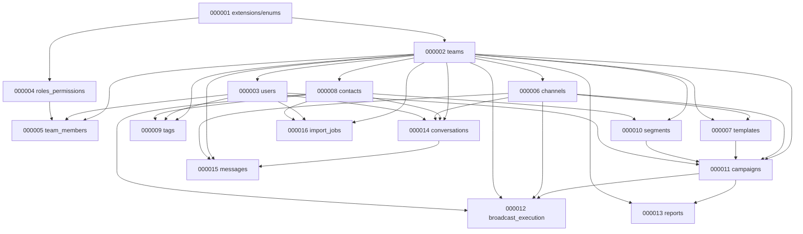

# Migration Plan — Omni-Chan v1 (Phase 9A)

**Tool:** [golang-migrate](https://github.com/golang-migrate/migrate)  
**Path:** `services/backend-service/migrations/`  
**Target:** PostgreSQL 16+

**Legacy note:** Pre-v1 migrations (`000001_init` … `000011_device_slug`) are archived under `migrations/archive/legacy-pre-v1/`. Fresh installs use the v1 chain below only. Existing databases that ran legacy migrations require a manual upgrade path (see §12).

Supersedes legacy `000012_rbac` (content merged into `000004_roles_permissions`).

---

## 1. Migration file inventory

| # | Up file | Down file | Module |
|---|---------|-----------|--------|
| 000001 | `000001_extensions_and_enums.up.sql` | `.down.sql` | Extensions + enum types |
| 000002 | `000002_teams_workspace.up.sql` | `.down.sql` | Teams / workspace |
| 000003 | `000003_users.up.sql` | `.down.sql` | Users + refresh tokens |
| 000004 | `000004_roles_permissions.up.sql` | `.down.sql` | Roles & permissions (RBAC seeds) |
| 000005 | `000005_team_members.up.sql` | `.down.sql` | Team members + invitations |
| 000006 | `000006_channels.up.sql` | `.down.sql` | Channels |
| 000007 | `000007_templates.up.sql` | `.down.sql` | Templates |
| 000008 | `000008_contacts.up.sql` | `.down.sql` | Contacts |
| 000009 | `000009_tags.up.sql` | `.down.sql` | Tags |
| 000010 | `000010_segments.up.sql` | `.down.sql` | Segments |
| 000011 | `000011_campaigns.up.sql` | `.down.sql` | Campaigns |
| 000012 | `000012_broadcast_execution.up.sql` | `.down.sql` | Broadcast execution |
| 000013 | `000013_reports.up.sql` | `.down.sql` | Reports |
| 000014 | `000014_conversations.up.sql` | `.down.sql` | Conversations |
| 000015 | `000015_messages.up.sql` | `.down.sql` | Messages |
| 000016 | `000016_import_jobs.up.sql` | `.down.sql` | Import jobs |

**Total:** 16 migrations × 2 files = **32 SQL files**

---

## 2. Dependency graph



---

## 3. Table creation order

1. `teams`, `workspace_readiness_snapshots`
2. `users`, `refresh_tokens` → FK `teams.owner_id`
3. `roles`, `permissions`, `role_permissions` (+ seeds)
4. `team_members`, `team_invitations`
5. `channels`, `channel_credentials`, `channel_onboarding`
6. `templates`
7. `contacts`
8. `tags`, `contact_tags`
9. `segments`, `segment_rules`, `segment_members`
10. `campaigns`, `campaign_audiences`
11. `broadcast_jobs`, `broadcast_batches`, `campaign_audience_snapshots`, `campaign_recipients` (+ status trigger)
12. `campaign_link_clicks`, `campaign_daily_stats`
13. `conversations`
14. `messages` (partitioned)
15. `contact_import_jobs`, `contact_import_files`, `contact_import_rows` → FK `contacts.import_job_id`

---

## 4. Required tables checklist

| Table | Migration | Status |
|-------|-----------|--------|
| teams | 000002 | ✓ |
| workspace_readiness_snapshots | 000002 | ✓ |
| users | 000003 | ✓ |
| refresh_tokens | 000003 | ✓ |
| team_members | 000005 | ✓ |
| roles | 000004 | ✓ |
| permissions | 000004 | ✓ |
| role_permissions | 000004 | ✓ |
| team_invitations | 000005 | ✓ |
| channels | 000006 | ✓ |
| channel_credentials | 000006 | ✓ |
| channel_onboarding | 000006 | ✓ |
| templates | 000007 | ✓ |
| contacts | 000008 | ✓ |
| tags | 000009 | ✓ |
| contact_tags | 000009 | ✓ |
| segments | 000010 | ✓ |
| segment_rules | 000010 | ✓ |
| segment_members | 000010 | ✓ |
| campaigns | 000011 | ✓ |
| campaign_audiences | 000011 | ✓ |
| campaign_audience_snapshots | 000012 | ✓ |
| broadcast_jobs | 000012 | ✓ |
| broadcast_batches | 000012 | ✓ |
| campaign_recipients | 000012 | ✓ |
| campaign_link_clicks | 000013 | ✓ |
| campaign_daily_stats | 000013 | ✓ |
| conversations | 000014 | ✓ |
| messages | 000015 | ✓ |
| contact_import_jobs | 000016 | ✓ |
| contact_import_files | 000016 | ✓ |
| contact_import_rows | 000016 | ✓ |

---

## 5. Constraints summary

### Unique (partial where noted)

| Table | Constraint |
|-------|------------|
| teams | `(LOWER(slug))` WHERE `deleted_at IS NULL` |
| users | `(LOWER(email))` WHERE `deleted_at IS NULL` |
| team_members | `(team_id, user_id)` WHERE `deleted_at IS NULL` |
| channels | `(team_id, phone_number_id)` WHERE active |
| templates | `(channel_id, meta_template_id)` WHERE active |
| templates | `(channel_id, name, language)` WHERE active |
| tags | `(team_id, LOWER(name))` WHERE active |
| contacts | `(team_id, phone)` WHERE `deleted_at IS NULL` |
| campaign_recipients | `(campaign_id, contact_id, created_at)` |
| campaign_audiences | `(campaign_id, source_type, source_id)` |
| broadcast_batches | `(job_id, batch_number)` |
| broadcast_jobs | one active per `campaign_id` (partial) |
| campaign_daily_stats | `(team_id, stat_date)` |
| conversations | `(team_id, contact_id, channel_id)` WHERE active |
| messages | `(wamid, created_at)` WHERE `wamid IS NOT NULL` |
| campaign_recipients | `(wamid, created_at)` WHERE `wamid IS NOT NULL` |

### Check constraints

- `teams.contact_limit > 0`, `teams.channel_limit > 0`
- `campaigns.*_count >= 0`
- `channel_onboarding.history_sync_progress` 0–100
- `workspace_readiness_snapshots.score` 0–100

### Trigger: monotonic recipient status

`enforce_recipient_status_monotonic()` on `campaign_recipients` BEFORE UPDATE OF status:

```
pending → queued | skipped | cancelled | failed
queued → sending | cancelled | failed
sending → sent | queued | failed | cancelled
sent → delivered | read | failed
delivered → read
terminal: read, failed, cancelled, skipped (no further changes)
```

---

## 6. Indexes summary

| Pattern | Tables |
|---------|--------|
| `team_id` | channels, templates, contacts, tags, segments, campaigns, conversations, messages, import_jobs, campaign_daily_stats |
| `channel_id` | templates, campaigns, conversations, messages |
| `campaign_id` | audiences, jobs, batches, recipients, link_clicks |
| `contact_id` | contact_tags, segment_members, conversations, recipients |
| `status` | channels, campaigns, broadcast_jobs, broadcast_batches, recipients, import_jobs |
| `created_at` / `scheduled_at` | teams, users, channels, templates, contacts, campaigns, recipients, messages |
| GIN trigram | `contacts.name`, `contacts.phone`, `contacts.email` |
| GIN JSONB | `templates.components` |

---

## 7. Partitioning strategy

| Table | Strategy | Initial partition |
|-------|----------|-------------------|
| `campaign_recipients` | `RANGE (created_at)` monthly | `campaign_recipients_default` (DEFAULT) |
| `messages` | `RANGE (created_at)` monthly | `messages_default` (DEFAULT) |
| `contact_import_rows` | `RANGE (created_at)` monthly | `contact_import_rows_default` (DEFAULT) |

**Not included in Phase 9A:**
- Monthly partition auto-creation job
- Partition detach/drop retention job

**Note:** PK and UNIQUE constraints include `created_at` (partition key requirement). Audience resolver MUST set uniform `created_at` per campaign snapshot batch so `(campaign_id, contact_id, created_at)` enforces one row per contact per campaign.

---

## 8. Teams plan defaults

| plan_type | contact_limit | channel_limit |
|-----------|---------------|---------------|
| starter | 50,000 | 1 |
| growth | 100,000 | 3 |
| business | 300,000 | 10 |
| enterprise | custom | custom |

Defaults on `teams`: `plan_type=starter`, `contact_limit=50000`, `channel_limit=1`. Application layer sets limits on plan change.

---

## 9. Risks and recommendations

| Risk | Impact | Recommendation |
|------|--------|----------------|
| Legacy `000012_rbac` already applied in dev DB | migrate version conflict | Reset DB or mark dirty + manual reconcile before `migrate-up` |
| Legacy `000001`–`000011` already applied | schema overlap with v1 | Use archived migrations folder; run greenfield on new DB or custom upgrade script |
| `devices` table in old deployments | channel rename | Data migration script: `INSERT INTO channels SELECT … FROM devices` (Phase 9B) |
| Partitioned UNIQUE on recipients | duplicate contact if `created_at` differs | Set `created_at = job.snapshot_at` in audience resolver |
| `campaign_link_clicks.recipient_id` no FK | orphan refs possible | Resolve by application; optional FK in v2 |
| Status trigger blocks webhook replay same status | none if UPDATE skipped | Use `WHERE status = $old` in UPDATE for idempotency |
| RBAC permission expansion | handler gaps | Map `device.*` → `channel.*` in middleware during transition |
| Trigger on partitioned parent | PG propagates to partitions | Verified PG 11+ behavior |

---

## 10. Apply instructions

```bash
cd services/backend-service
make migrate-up    # requires DATABASE_URL
make migrate-down  # rolls back one version at a time
```

Fresh database: all 16 migrations apply sequentially.  
API auto-migrates on boot (`cmd/api/main.go`).

---

## 12. Legacy upgrade path (existing deployments)

If a database already ran archived migrations (`devices`, `campaign_contacts`, etc.):

1. Dump and restore to staging.
2. Do **not** run v1 `000001`–`000016` on top of legacy schema without transformation.
3. Option A: **Greenfield** — new database + data ETL scripts (recommended for staging).
4. Option B: **Incremental** — author `000012_v1_upgrade` migrations that ALTER/RENAME legacy tables to v1 (Phase 9B scope).

Archived files preserved at: `migrations/archive/legacy-pre-v1/`

---

## 11. Schema validation report

| Check | Result |
|-------|--------|
| All required tables present | **PASS** (31 tables) |
| UUID primary keys | **PASS** |
| TIMESTAMPTZ timestamps | **PASS** |
| JSONB where specified | **PASS** (`templates.components`, `campaigns.variable_mapping`, import `raw_data`, readiness `checks`) |
| Soft delete `deleted_at` on required entities | **PASS** |
| `marketing_status` on contacts | **PASS** (`subscribed`, `unsubscribed`, `unknown`) |
| `plan_type` on teams | **PASS** (`starter`, `growth`, `business`, `enterprise`) |
| `recipient_status` full enum | **PASS** (9 values) |
| `campaign_recipients` execution columns | **PASS** (`job_id`, `batch_id`, `wamid`, `attempt_count`, `last_error`, timestamps) |
| Broadcast execution tables | **PASS** |
| Partial unique indexes | **PASS** |
| GIN trigram on contacts | **PASS** |
| Partition-ready tables | **PASS** (3 tables + DEFAULT partitions) |
| Monotonic status enforcement | **PASS** (trigger) |
| `wamid` indexed for idempotency | **PASS** (recipients + messages) |
| Aligns with API v1 contract | **PASS** |
| Aligns with broadcast execution architecture | **PASS** |
| No Go code generated | **PASS** |

**Pending runtime validation:** execute `make migrate-up` against PostgreSQL 16+ and confirm zero errors.

---

*Phase 9A complete — awaiting review before Phase 9B Repository Layer.*
