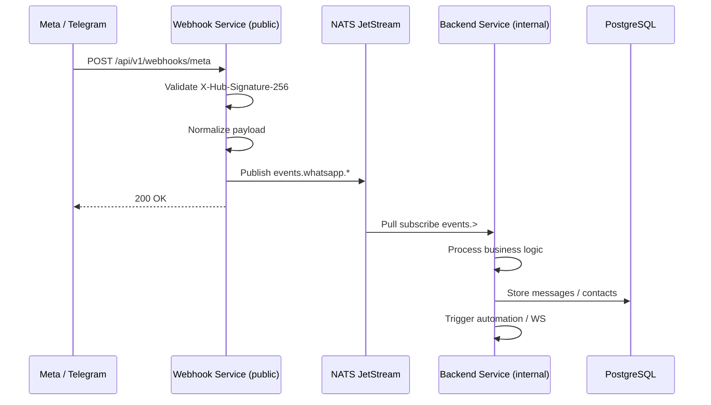

# Migration Guide: Monolith Webhooks → Webhook Service

This guide describes how to migrate from the previous architecture (webhooks on the main backend) to the split **Webhook Service** + **Backend Service** model.

## Architecture Overview



## Folder Structure

```
omni-chan-v2/
├── shared/                    # Shared events, NATS, validation, normalizers
├── services/
│   ├── webhook-service/       # Public webhook ingress only
│   └── backend-service/       # REST API, auth, DB, consumers (was backend/)
├── docker-compose.yml
└── go.work
```

## Breaking Changes

| Before | After |
|--------|-------|
| `POST /api/v1/webhooks/meta` on backend | Same path on **webhook-service** (port 8081) |
| Webhook handled synchronously in backend | Events published to NATS, backend consumes async |
| Single `backend/` folder | `services/backend-service/` |

Webhook paths (unchanged from monolith):

- `GET/POST /api/v1/webhooks/meta`
- `POST /api/v1/webhooks/telegram`

## Migration Steps

### 1. Infrastructure

```bash
docker compose up -d nats postgres redis
```

### 2. Environment Variables

**Webhook Service** (`services/webhook-service/.env`):

```env
HTTP_PORT=8081
NATS_URL=nats://localhost:4222
INTERNAL_SERVICE_TOKEN=<strong-random-token>
META_APP_SECRET=<from-meta-console>
META_VERIFY_TOKEN=<from-meta-console>
TELEGRAM_WEBHOOK_SECRET=<optional>
```

**Backend Service** (`services/backend-service/.env`):

```env
HTTP_PORT=8090
NATS_URL=nats://localhost:4222
NATS_CONSUMER_ENABLED=true
INTERNAL_SERVICE_TOKEN=<same-as-webhook-service>
# ... existing DATABASE_URL, JWT, Redis, etc.
```

### 3. Update Meta Developer Console

Change Callback URL from:

```
https://api.example.com/api/v1/webhooks/meta
```

To (via reverse proxy to webhook-service only):

```
https://webhooks.example.com/api/v1/webhooks/meta
```

Keep the same **Verify Token** (`META_VERIFY_TOKEN`).

### 4. Reverse Proxy / Firewall

- **Public**: webhook-service `:8081` (or 443 via Nginx)
- **Internal only**: backend-service `:8090` (VPN / private network / Docker internal network)
- **Block** direct public access to backend REST API in production

Example Nginx:

```nginx
# Public webhooks
server {
    listen 443 ssl;
    server_name webhooks.example.com;
    location / {
        proxy_pass http://127.0.0.1:8081;
    }
}

# Internal API (not public)
server {
    listen 443 ssl;
    server_name api.example.com;
    allow 10.0.0.0/8;
    deny all;
    location / {
        proxy_pass http://127.0.0.1:8090;
    }
}
```

### 5. Run Services

```bash
# Terminal 1
make run-webhook

# Terminal 2
make run-backend
```

Or with Docker:

```bash
docker compose up -d --build
```

### 6. Verify

```bash
curl http://localhost:8081/health
curl http://localhost:8090/api/v1/health
```

Send a test Meta webhook to webhook-service and confirm backend logs show `webhook event consumer started` and message processing.

## Event Types (NATS subjects)

| Event Type | NATS Subject |
|------------|--------------|
| `whatsapp.message.received` | `events.whatsapp.message.received` |
| `whatsapp.message.status` | `events.whatsapp.message.status` |
| `whatsapp.template.status` | `events.whatsapp.template.status` |
| `whatsapp.account.update` | `events.whatsapp.account.update` |
| `telegram.message.received` | `events.telegram.message.received` |
| `telegram.callback.received` | `events.telegram.callback.received` |

## Rollback

1. Point Meta callback URL back to monolith endpoint (if still deployed).
2. Set `NATS_CONSUMER_ENABLED=false` on backend.
3. Temporarily re-enable webhook routes on backend (git revert of meta handler split).

## Deploy Script Update

`deploy/install-backend-service.sh` now builds from `services/backend-service/`. Update paths on servers accordingly.
