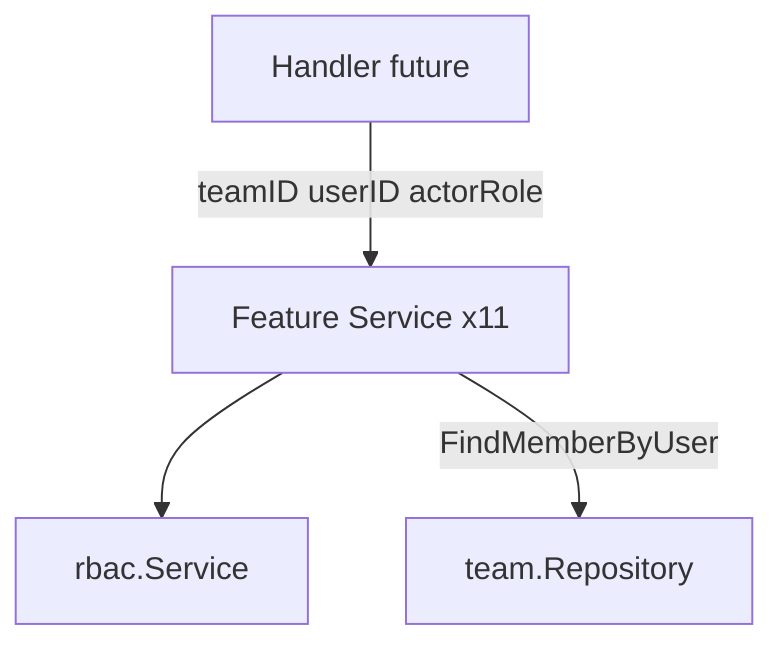
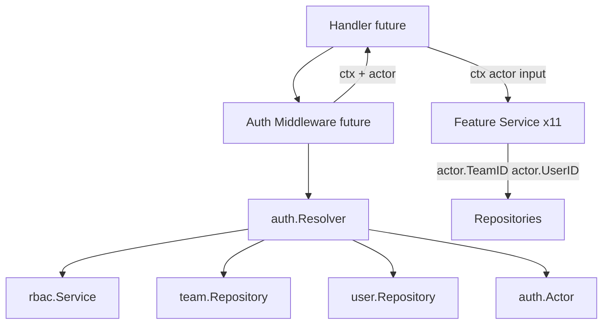

# Phase 9.5 — Request Context & Actor Model

**Status:** Ready for review  
**Scope:** Analysis and implementation design only  
**No code changes in this phase** — no handlers, JWT, middleware, or workers

---

## 1. Problem Statement

Phase 9C services accept fragmented identity inputs:

```go
func (s *Service) Create(
    ctx context.Context,
    teamID, userID uuid.UUID,
    actorRole string,
    input CreateInput,
) (*Contact, error)
```

This creates five recurring issues:

| Issue | Example |
|-------|---------|
| **Redundant parameters** | `teamID` + `userID` + `actorRole` repeat JWT claims already known at the boundary |
| **Duplicated RBAC logic** | 11 services each define private `authorize(role, perm)` calling `rbac.Service.Require` |
| **Role-only authorization** | Permission resolved from role name on every call; no permission snapshot on the actor |
| **Repeated membership checks** | 11 copies of `ensureMember` → `FindMemberByUser` per request |
| **Weak audit trail** | `created_by` set manually from `userID`; no standard actor for `updated_by` or future `audit_logs` |

**Goal:** One authenticated **Actor** value passed into every service method, replacing `actorRole string` and collapsing redundant identity parameters.

---

## 2. Actor Model

### 2.1 Package placement

```
internal/auth/
  actor.go       # Actor, Permissions, validation helpers
  actor_rbac.go  # HasPermission, RequirePermission (methods on Actor)
  context.go     # context key + ActorFromContext (Phase 10 — not implemented in 9.5)
  resolver.go    # ActorResolver interface + design (Phase 10)
```

`auth.Actor` lives in `internal/auth` alongside session/login types. It is **not** a JWT claim struct — it is the **resolved workspace principal** built once per request at the handler boundary (future).

### 2.2 Type definition (proposed)

```go
package auth

import "github.com/google/uuid"

// Actor is the authenticated workspace principal for a single request.
// Built at the HTTP/middleware boundary; passed explicitly into services.
type Actor struct {
    UserID      uuid.UUID
    TeamID      uuid.UUID
    Role        string            // role name: owner, admin, supervisor, agent
    RoleID      uuid.UUID         // FK to roles.id (for audit + RBAC stability)
    Permissions map[string]bool   // snapshot: permission code → granted
    Email       string            // optional; useful for audit display
    MemberID    uuid.UUID         // team_members.id; optional but recommended
}

// Permissions is a set of granted permission codes.
type Permissions map[string]bool

func (p Permissions) Has(code string) bool {
    return p[code]
}
```

### 2.3 Field semantics

| Field | Source | Used for |
|-------|--------|----------|
| `user_id` | JWT `Claims.UserID` | `created_by`, audit actor, inbox assignment |
| `team_id` | JWT `Claims.TeamID` | Tenant scoping on all repository calls |
| `role` | `team_members.role` or JWT `Claims.Role` | Display, legacy compatibility, audit |
| `role_id` | `team_members.role_id` | Stable reference if role name changes |
| `permissions` | RBAC cache snapshot for role | Authorization without per-call cache lookup |
| `email` | `users.email` | Audit log human-readable identity |
| `member_id` | `team_members.id` | Team-member-scoped operations |

### 2.4 Invariants

An `Actor` MUST satisfy:

1. `UserID` and `TeamID` are non-nil UUIDs.
2. `Permissions` is non-nil (empty map = no permissions).
3. Actor was resolved with an **active** `team_members` row (`deleted_at IS NULL`, `status = active`).
4. `Actor.TeamID` matches the workspace being accessed (handlers enforce; services call `actor.AssertTeam(teamID)` when route param present).

### 2.5 Special actors (workers / internal)

For NATS workers and cron jobs (future phases):

```go
// SystemActor — internal automation within a team scope.
func SystemActor(teamID uuid.UUID, purpose string) Actor

// WorkerActor — scoped permissions for a worker type.
func WorkerActor(teamID uuid.UUID, permissions Permissions, workerName string) Actor
```

Workers do **not** use JWT. They receive a pre-built `Actor` at job enqueue time or construct a `SystemActor` with explicit permission subset (e.g. `campaign.send` only).

---

## 3. RBAC API

### 3.1 Design principle

Move authorization from **per-service `rbac.Service` injection** to **methods on `Actor`**, backed by the permission snapshot loaded at resolve time.

Services stop calling `rbac.Service.Require(role, code)`. They call `actor.RequirePermission(code)`.

### 3.2 Proposed API

```go
// internal/auth/actor_rbac.go

import "github.com/omnichannel/omni-chan-v2/pkg/serviceerrors"

// HasPermission reports whether the actor has the given permission code.
func (a Actor) HasPermission(code string) bool {
    if a.Permissions == nil {
        return false
    }
    return a.Permissions[code]
}

// RequirePermission returns nil if granted, serviceerrors.ErrForbidden otherwise.
func (a Actor) RequirePermission(code string) error {
    if !a.HasPermission(code) {
        return serviceerrors.ErrForbidden
    }
    return nil
}

// RequireAnyPermission returns nil if any code is granted.
func (a Actor) RequireAnyPermission(codes ...string) error { ... }

// AssertTeam returns ErrForbidden if teamID does not match actor workspace.
func (a Actor) AssertTeam(teamID uuid.UUID) error { ... }
```

### 3.3 Relationship to existing `rbac` package

| Current (Phase 9C) | Proposed (Phase 9.5+) |
|--------------------|------------------------|
| `rbac.Service.Require(role, code) bool` | Used only during **Actor resolution** |
| `rbac.Service.HasPermission(ctx, role, code)` | Used only during **Actor resolution** |
| `rbac.RequirePermission(service, code) fiber.Handler` | Stays in middleware (Phase 10); uses same permission codes |
| Per-service `authorize(actorRole, perm)` | **Removed** — replaced by `actor.RequirePermission(perm)` |

**Permission codes** remain in `internal/rbac/permissions.go` (`rbac.PermContactView`, etc.). `auth` imports `rbac` only for constant re-exports if desired:

```go
// optional convenience in auth package
const PermContactView = rbac.PermContactView
```

### 3.4 Actor resolution (Phase 10 — design only)

```go
// internal/auth/resolver.go

type Resolver interface {
    Resolve(ctx context.Context, userID, teamID uuid.UUID) (Actor, error)
}

type resolver struct {
    teams team.Repository
    users user.Repository
    rbac  *rbac.Service
}

func (r *resolver) Resolve(ctx context.Context, userID, teamID uuid.UUID) (Actor, error) {
    member, err := r.teams.FindMemberByUser(ctx, teamID, userID)
    // → ErrForbidden if not member / inactive

    perms := r.rbac.PermissionsForRole(member.Role) // new rbac helper
    user, _ := r.users.FindByID(ctx, userID)

    return Actor{
        UserID:      userID,
        TeamID:      teamID,
        Role:        string(member.Role),
        RoleID:      member.RoleID,
        MemberID:    member.ID,
        Email:       user.Email,
        Permissions: perms,
    }, nil
}
```

New `rbac` helper (Phase 10 implementation):

```go
func (s *Service) PermissionsForRole(roleName string) map[string]bool
```

---

## 4. Service Signature Migration

### 4.1 Standard pattern

**Before (Phase 9C):**

```go
func (s *Service) Create(
    ctx context.Context,
    teamID, userID uuid.UUID,
    actorRole string,
    input CreateInput,
) (*Contact, error) {
    if err := s.authorize(actorRole, rbac.PermContactCreate); err != nil { ... }
    if err := s.ensureMember(ctx, teamID, userID); err != nil { ... }
    ...
}
```

**After (Phase 9.5+):**

```go
func (s *Service) Create(
    ctx context.Context,
    actor auth.Actor,
    input CreateInput,
) (*Contact, error) {
    if err := actor.RequirePermission(rbac.PermContactCreate); err != nil { ... }
    // membership already proven at resolve time; optional: actor.AssertTeam(teamID)
    c.TeamID = actor.TeamID
    c.CreatedBy = &actor.UserID  // audit-ready
    ...
}
```

### 4.2 Parameter collapse rules

| Remove | Replace with |
|--------|--------------|
| `teamID uuid.UUID` | `actor.TeamID` |
| `userID uuid.UUID` / `actorID uuid.UUID` | `actor.UserID` |
| `actorRole string` | `actor.Role` (read-only) + `actor.Permissions` (authz) |
| `ensureMember(...)` | Actor resolution at boundary (or `actor.AssertTeam`) |
| `s.authorize(...)` | `actor.RequirePermission(...)` |
| `s.rbac *rbac.Service` field on services | **Removed** from all 11 services |

### 4.3 Full method inventory (58 methods)

#### `workspace.Service` (5)

| Method | Before | After |
|--------|--------|-------|
| `Get` | `(ctx, teamID, userID, actorRole)` | `(ctx, actor)` |
| `GetDetail` | `(ctx, teamID, userID, actorRole)` | `(ctx, actor)` |
| `Update` | `(ctx, teamID, userID, actorRole, input)` | `(ctx, actor, input)` |
| `GetQuotas` | `(ctx, teamID, userID, actorRole)` | `(ctx, actor)` |
| `IsOwner` | `(ctx, teamID, userID)` | `(ctx, actor)` — compare `actor.UserID` |

#### `team.Service` (11)

| Method | Before | After |
|--------|--------|-------|
| `Get` | `(ctx, teamID, userID)` | `(ctx, actor)` |
| `Update` | `(ctx, teamID, userID, actorRole, name)` | `(ctx, actor, name)` |
| `ListMembers` | `(ctx, teamID, userID)` | `(ctx, actor)` |
| `ListUsers` | `(ctx, teamID, userID, actorRole, filter)` | `(ctx, actor, filter)` |
| `AddMember` | `(ctx, teamID, actorID, actorRole, email, role)` | `(ctx, actor, email, role)` |
| `InviteUser` | `(ctx, teamID, actorID, actorRole, name, email, role)` | `(ctx, actor, name, email, role)` |
| `UpdateMemberRole` | `(ctx, teamID, actorID, actorRole, memberID, newRole)` | `(ctx, actor, memberID, newRole)` |
| `DeactivateMember` | `(ctx, teamID, actorID, actorRole, memberID)` | `(ctx, actor, memberID)` |
| `RemoveMember` | `(ctx, teamID, actorID, actorRole, memberID)` | `(ctx, actor, memberID)` |
| `GetWorkspace` | `(ctx, teamID, userID, actorRole)` | `(ctx, actor)` |
| `CreateOwnerMember` | `(ctx, teamID, userID)` | `(ctx, actor)` or keep system-only `(ctx, teamID, userID)` for registration bootstrap |

#### `channel.Service` (6)

| Method | Before | After |
|--------|--------|-------|
| `Create` | `(ctx, teamID, userID, actorRole, input)` | `(ctx, actor, input)` |
| `Get` | `(ctx, teamID, userID, actorRole, channelID)` | `(ctx, actor, channelID)` |
| `List` | `(ctx, teamID, userID, actorRole, filter, page)` | `(ctx, actor, filter, page)` |
| `Update` | `(ctx, teamID, userID, actorRole, channelID, input)` | `(ctx, actor, channelID, input)` |
| `Delete` | `(ctx, teamID, userID, actorRole, channelID)` | `(ctx, actor, channelID)` |
| `GetOnboarding` | `(ctx, teamID, userID, actorRole, channelID)` | `(ctx, actor, channelID)` |

#### `template.Service` (3)

| Method | Before | After |
|--------|--------|-------|
| `Get` | `(ctx, teamID, userID, actorRole, templateID)` | `(ctx, actor, templateID)` |
| `List` | `(ctx, teamID, userID, actorRole, filter, page)` | `(ctx, actor, filter, page)` |
| `UpsertFromSync` | `(ctx, teamID, actorRole, tmpl)` | `(ctx, actor, tmpl)` |

#### `contact.Service` (5)

| Method | Before | After |
|--------|--------|-------|
| `Create` | `(ctx, teamID, userID, actorRole, input)` | `(ctx, actor, input)` |
| `Get` | `(ctx, teamID, userID, actorRole, contactID)` | `(ctx, actor, contactID)` |
| `List` | `(ctx, teamID, userID, actorRole, filter, page)` | `(ctx, actor, filter, page)` |
| `Update` | `(ctx, teamID, userID, actorRole, contactID, input)` | `(ctx, actor, contactID, input)` |
| `Delete` | `(ctx, teamID, userID, actorRole, contactID)` | `(ctx, actor, contactID)` |

#### `segment.Service` (5)

Same pattern as `contact.Service` — `(ctx, actor, ...)`.

#### `campaign.Service` (5)

| Method | Before | After |
|--------|--------|-------|
| `Create` | `(ctx, teamID, userID, actorRole, input)` | `(ctx, actor, input)` — sets `CreatedBy = &actor.UserID` |
| `Get` | `(ctx, teamID, userID, actorRole, campaignID)` | `(ctx, actor, campaignID)` |
| `List` | `(ctx, teamID, userID, actorRole, filter, page)` | `(ctx, actor, filter, page)` |
| `Update` | `(ctx, teamID, userID, actorRole, campaignID, input)` | `(ctx, actor, campaignID, input)` |
| `Delete` | `(ctx, teamID, userID, actorRole, campaignID)` | `(ctx, actor, campaignID)` |

#### `report.Service` (5)

All `(ctx, teamID, userID, actorRole, ...)` → `(ctx, actor, ...)`.

Exception: `RecordLinkClick(ctx, click)` — no actor today (webhook). Future: `(ctx, actor auth.Actor, click)` or `SystemActor`.

#### `conversation.Service` (5)

All user-facing methods → `(ctx, actor, ...)`.

`RecordInboundPreview(ctx, teamID, conversationID, preview)` → `(ctx, actor, conversationID, preview)` or worker `SystemActor`.

#### `message.Service` (3)

| Method | Before | After |
|--------|--------|-------|
| `Create` | `(ctx, teamID, userID, actorRole, input)` | `(ctx, actor, input)` |
| `ListByConversation` | `(ctx, teamID, userID, actorRole, ...)` | `(ctx, actor, ...)` |
| `UpdateDeliveryStatus` | `(ctx, wamid, status)` | `(ctx, actor, wamid, status)` or `SystemActor` for webhooks |

#### `importjob.Service` (3)

`CreateJob`, `GetJob`, `ListJobs` → `(ctx, actor, ...)`.

Internal worker methods (`MarkProcessing`, `CompleteJob`, `AddFile`, `RecordRows`) → accept `SystemActor` or dedicated worker actor.

---

## 5. Dependency Graph

### 5.1 Before (Phase 9C)



Every service depends on `rbac.Service` + `team.Repository` for authz and membership.

### 5.2 After (Phase 9.5+)



**Key change:** `rbac.Service` moves to the **resolution boundary** only. Feature services depend on `auth.Actor` (value type), not on `rbac.Service`.

### 5.3 Service constructor simplification

**Before:**

```go
func NewService(contacts Repository, teams team.Repository, quota *quota.Service, rbac *rbac.Service) *Service
```

**After:**

```go
func NewService(contacts Repository, quota *quota.Service) *Service
// team.Repository removed where only used for ensureMember
```

| Service | Dependencies removed after Actor |
|---------|----------------------------------|
| workspace | `rbac.Service` (optional keep for IsOwner role lookup) |
| team | `rbac.Service` |
| channel, template, contact, segment, campaign, report, conversation, message, importjob | `rbac.Service`, `team.Repository` (if only used for `ensureMember`) |

---

## 6. Context Propagation (Phase 10 design)

Phase 9.5 uses **explicit `actor` parameters** (clearer for testing). Phase 10 may additionally store actor in context:

```go
type ctxKey struct{}

func WithActor(ctx context.Context, actor Actor) context.Context
func ActorFromContext(ctx context.Context) (Actor, error)
```

**Recommendation:** Use explicit `actor auth.Actor` in service signatures. Context storage is optional for handlers/logging only — services should not rely solely on `ActorFromContext` to keep unit tests simple.

---

## 7. Future Audit Compatibility

### 7.1 Existing schema hooks

Tables already include actor FK columns (Phase 9A):

| Table | Column | Current service usage |
|-------|--------|----------------------|
| `campaigns` | `created_by` | `CampaignService.Create` sets from `userID` |
| `contact_import_jobs` | `created_by` | `ImportService.CreateJob` sets from `userID` |
| `team_invitations` | `invited_by` | `TeamService.InviteUser` sets from `actorID` |

No `updated_by` columns exist yet. No `audit_logs` table in migrations.

### 7.2 Proposed audit helper (Phase 11+)

```go
// internal/audit/context.go

type Entry struct {
    TeamID     uuid.UUID
    ActorID    uuid.UUID
    ActorEmail string
    Action     string         // e.g. "campaign.create"
    EntityType string         // e.g. "campaign"
    EntityID   uuid.UUID
    Metadata   map[string]any
}

type Recorder interface {
    Record(ctx context.Context, entry Entry) error
}

// Actor convenience
func (a Actor) AuditIdentity() (userID uuid.UUID, email string) {
    return a.UserID, a.Email
}
```

### 7.3 Service write pattern

```go
func (s *Service) Create(ctx context.Context, actor auth.Actor, input CreateInput) (*Campaign, error) {
    if err := actor.RequirePermission(rbac.PermCampaignCreate); err != nil {
        return nil, err
    }

    c := &Campaign{
        TeamID:    actor.TeamID,
        CreatedBy: &actor.UserID,
        ...
    }
    // future:
    // defer s.audit.Record(ctx, audit.Entry{ActorID: actor.UserID, Action: "campaign.create", ...})
}
```

### 7.4 Planned `audit_logs` table (not migrated)

```sql
CREATE TABLE audit_logs (
    id UUID PRIMARY KEY DEFAULT gen_random_uuid(),
    team_id UUID NOT NULL REFERENCES teams (id),
    actor_id UUID REFERENCES users (id),
    actor_role VARCHAR(32),
    action VARCHAR(64) NOT NULL,
    entity_type VARCHAR(64) NOT NULL,
    entity_id UUID,
    metadata JSONB NOT NULL DEFAULT '{}',
    ip_address INET,
    user_agent TEXT,
    created_at TIMESTAMPTZ NOT NULL DEFAULT NOW()
);
CREATE INDEX idx_audit_logs_team_created ON audit_logs (team_id, created_at DESC);
CREATE INDEX idx_audit_logs_entity ON audit_logs (entity_type, entity_id);
```

`Actor` supplies `team_id`, `user_id`, `role`, `email` for every row without re-querying.

### 7.5 Worker / webhook actors

| Caller | Actor type | `actor_id` in audit |
|--------|------------|---------------------|
| REST handler | Resolved `Actor` | `actor.UserID` |
| Campaign worker | `WorkerActor(teamID, perms, "campaign_sender")` | `NULL` + metadata `worker=campaign_sender` |
| Meta webhook | `SystemActor(teamID, "meta_webhook")` | `NULL` + metadata `source=meta` |

---

## 8. Migration Impact

### 8.1 Files to create (Phase 9.5 implementation)

| File | Purpose |
|------|---------|
| `internal/auth/actor.go` | `Actor`, `Permissions`, `AssertTeam` |
| `internal/auth/actor_rbac.go` | `HasPermission`, `RequirePermission` |
| `internal/auth/actor_test.go` | Unit tests for RBAC methods |

### 8.2 Files to modify (Phase 9.5 implementation)

| Area | Count | Change |
|------|-------|--------|
| Service `service.go` files | 11 | Signature + remove `authorize` / `ensureMember` / `rbac` field |
| Service tests | ~5 | Pass `auth.Actor{...}` fixtures |
| `internal/rbac/service.go` | 1 | Add `PermissionsForRole(role) map[string]bool` |
| Handlers (Phase 10) | ~15 | Build actor via resolver; pass to services |
| `cmd/api/main.go` (Phase 10) | 1 | Wire `auth.Resolver` |

### 8.3 Breaking changes

- **All service public methods** — breaking for any caller (handlers, tests, workers).
- **Service constructors** — `rbac` and possibly `teams` params removed.
- **No API contract change** — HTTP paths unchanged; only internal Go signatures.

### 8.4 Rollout strategy (recommended)

| Step | Phase | Work |
|------|-------|------|
| 1 | **9.5** | Add `auth.Actor` + RBAC methods + tests (no service migration) |
| 2 | **9.5b** | Migrate services one module at a time (team → workspace → contact → …) |
| 3 | **10** | Add `auth.Resolver`, middleware builds actor, update handlers |
| 4 | **11** | `audit_logs` migration + `audit.Recorder` |

### 8.5 Risk: JWT role drift

JWT currently embeds `role` string (`pkg/jwt/Claims`). If member role changes server-side, JWT role may be stale until refresh.

**Mitigation:** Actor resolution MUST load role from `team_members`, not trust JWT role alone. JWT provides `user_id` + `team_id`; resolver loads fresh role + permissions.

---

## 9. Testing Strategy

### 9.1 Actor fixtures

```go
func testActor(perms ...string) auth.Actor {
    p := auth.Permissions{}
    for _, code := range perms {
        p[code] = true
    }
    return auth.Actor{
        UserID:      uuid.New(),
        TeamID:      uuid.New(),
        Role:        "admin",
        Permissions: p,
    }
}
```

### 9.2 Test cases

| Case | Assertion |
|------|-----------|
| Missing permission | `actor.RequirePermission` → `ErrForbidden` |
| Wrong team | `actor.AssertTeam(otherTeamID)` → `ErrForbidden` |
| Service create | `CreatedBy == actor.UserID` |
| No rbac.Service mock needed | Permissions baked into actor |

---

## 10. Out of Scope (Phase 9.5)

- HTTP handlers
- JWT changes
- Fiber middleware
- `auth.Resolver` implementation
- `context.Context` actor storage
- `audit_logs` migration
- NATS worker actor wiring
- Service signature migration (design documented; implementation in 9.5b)

---

## 11. Review Checklist

- [ ] `auth.Actor` fields cover user, team, role, permissions
- [ ] `HasPermission` / `RequirePermission` defined on Actor
- [ ] All 58 service methods mapped to new signatures
- [ ] `rbac.Service` scoped to resolution boundary only
- [ ] Membership check moved out of per-service `ensureMember`
- [ ] `created_by` / future `audit_logs` compatibility documented
- [ ] Worker/webhook `SystemActor` pattern defined
- [ ] JWT role staleness mitigation documented
- [ ] No handlers, JWT, or middleware implemented in this phase

---

## 12. Next Phase (9.5b suggestion)

1. Implement `internal/auth/actor.go` + `actor_rbac.go` + tests
2. Add `rbac.Service.PermissionsForRole`
3. Migrate `team` + `workspace` services first (smallest blast radius)
4. Migrate remaining 9 services
5. Update service unit tests with actor fixtures
