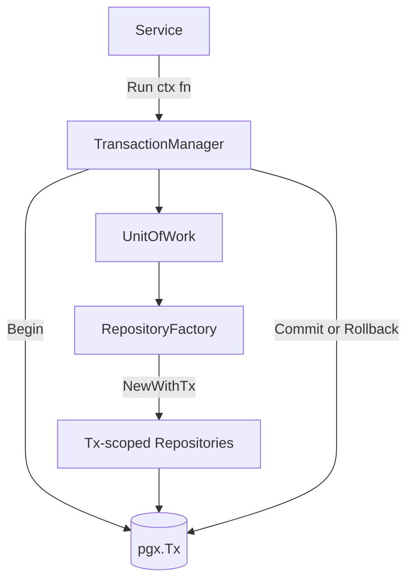
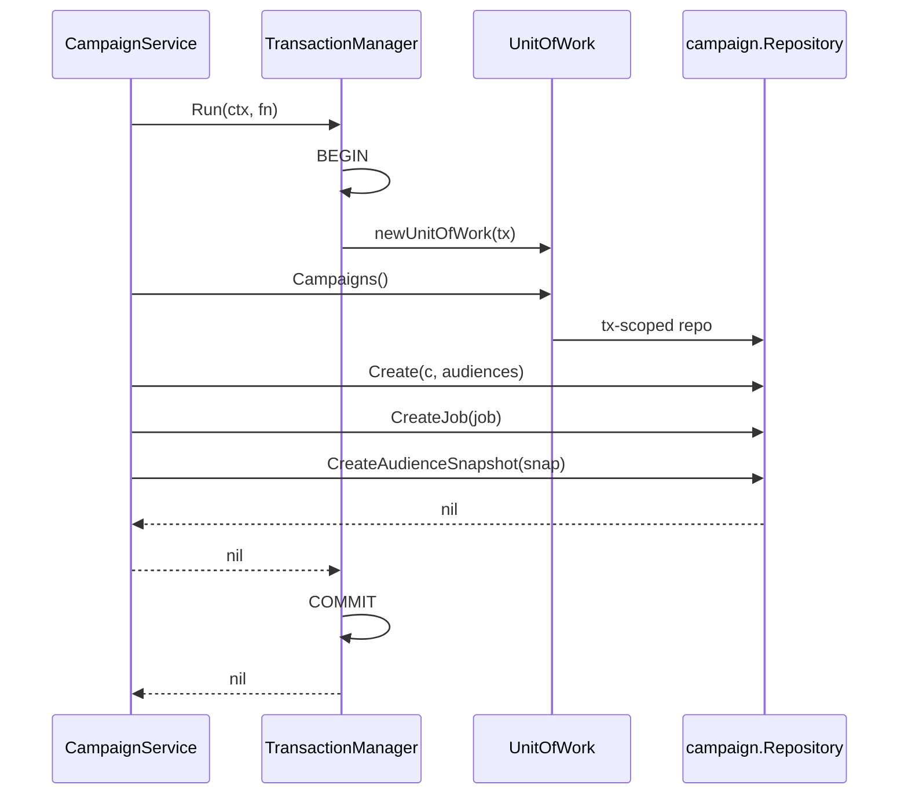
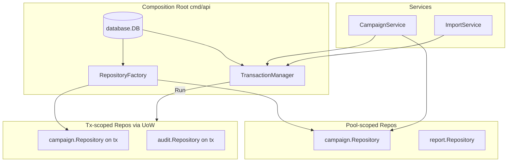

# Phase 9.6 — Unit of Work Design

**Status:** Ready for review  
**Scope:** Analysis and implementation design only  
**No code changes in this phase** — no implementation, handlers, or workers

---

## 1. Problem Statement

Phase 9B repositories wrap **single-feature** writes in local `database.WithTx` calls. Phase 9C services orchestrate **multi-step** business flows across multiple repository methods — each method may open its **own** transaction on the connection pool.

### 1.1 Campaign create today (broken atomicity)

Current `CampaignService.Create` (Phase 9C):

```
1. campaigns.Create(c, audiences)     → TX₁ (campaign + campaign_audiences) → COMMIT
2. campaigns.CreateJob(job)           → autocommit on pool
3. campaigns.CreateAudienceSnapshot() → autocommit on pool
   on failure → compensating SoftDelete(campaign)   ← not atomic, race-prone
```

| Step | Table(s) | Transaction |
|------|----------|-------------|
| 1 | `campaigns`, `campaign_audiences` | `TX₁` inside `campaign.Repository.Create` |
| 2 | `broadcast_jobs` | Separate autocommit |
| 3 | `campaign_audience_snapshots` | Separate autocommit |

**Failure modes without UoW:**

| Failure point | Visible state | Compensating action today |
|---------------|---------------|---------------------------|
| After step 1 | Draft campaign exists, no job | None needed |
| After step 2 | Campaign + job, no snapshot | `SoftDelete` campaign (job orphaned until FK cascade) |
| After step 3 | Complete | — |
| Crash between steps | Partial | Manual cleanup / inconsistent reads |

`broadcast_jobs` has FK `campaign_id → campaigns ON DELETE CASCADE`, so soft-deleting the campaign eventually cleans the job — but the window between steps 2–3 exposes incomplete state to concurrent readers.

### 1.2 Other cross-repository flows (current + future)

| Flow | Tables / repos | Today | Needs UoW |
|------|----------------|-------|-----------|
| Campaign draft create | campaigns, audiences, jobs, snapshots | Compensating delete | **Yes** |
| Campaign send (future) | campaigns, jobs, batches, recipients, snapshots | Not implemented | **Yes** |
| Import job complete (future) | import_jobs, contacts, import_rows, audit_logs | Partial | **Yes** |
| Segment create | segments, segment_rules | Single-repo `WithTx` | No |
| Import bulk rows | contact_import_rows | Single-repo `WithTx` | No |
| Report link click + daily stat | link_clicks, campaign_daily_stats | Two autocommit calls | Optional |
| Audit on any write (future) | entity table + `audit_logs` | N/A | **Yes** |

---

## 2. Goal

**Single transaction boundary** for service-orchestrated multi-repository writes:

```
BEGIN
  INSERT campaigns …
  INSERT campaign_audiences …
  INSERT broadcast_jobs …
  INSERT campaign_audience_snapshots …
  -- future: INSERT audit_logs …
COMMIT   (or ROLLBACK on any error)
```

Business validation stays in **services**. SQL stays in **repositories**. Transaction coordination moves to **UnitOfWork**.

---

## 3. Design Overview

Three collaborating types:



| Component | Responsibility |
|-----------|----------------|
| **TransactionManager** | Owns `BEGIN` / `COMMIT` / `ROLLBACK`; exposes `Run` callback |
| **UnitOfWork** | Holds one `pgx.Tx`; provides tx-scoped repository accessors |
| **RepositoryFactory** | Constructs repository implementations bound to a `Querier` (the tx) |

**Package placement (proposed):**

```
pkg/uow/
  manager.go      # TransactionManager
  unit_of_work.go # UnitOfWork interface + implementation
  factory.go      # RepositoryFactory
```

---

## 4. Interfaces

### 4.1 TransactionManager

```go
package uow

import "context"

// TransactionManager coordinates a single database transaction across repositories.
type TransactionManager interface {
    // Run executes fn inside a transaction.
    // Commits on nil error; rolls back on non-nil error or panic.
    Run(ctx context.Context, fn func(ctx context.Context, uow UnitOfWork) error) error
}
```

Implementation wraps existing `database.DB.WithTx`:

```go
type manager struct {
    db      *database.DB
    factory RepositoryFactory
}

func NewManager(db *database.DB, factory RepositoryFactory) TransactionManager {
    return &manager{db: db, factory: factory}
}

func (m *manager) Run(ctx context.Context, fn func(ctx context.Context, uow UnitOfWork) error) error {
    return m.db.WithTx(ctx, func(tx pgx.Tx) error {
        uow := newUnitOfWork(tx, m.factory)
        return fn(ctx, uow)
    })
}
```

### 4.2 UnitOfWork

```go
// UnitOfWork provides repositories sharing one pgx.Tx.
type UnitOfWork interface {
    // Feature repositories (expand as needed)
    Campaigns() campaign.Repository
    Contacts() contact.Repository
    ImportJobs() importjob.Repository
    // Audit() audit.Repository   // Phase 11

    // Tx returns the underlying transaction (escape hatch; avoid in services)
    Tx() pgx.Tx
}
```

**Design rule:** Services MUST NOT call `Tx()` directly. Only repositories use the querier inside UoW.

```go
type unitOfWork struct {
    tx      pgx.Tx
    factory RepositoryFactory

    // lazy-init caches (one repo instance per UoW)
    campaigns  campaign.Repository
    contacts   contact.Repository
    importJobs importjob.Repository
}

func (u *unitOfWork) Campaigns() campaign.Repository {
    if u.campaigns == nil {
        u.campaigns = u.factory.Campaigns(u.tx)
    }
    return u.campaigns
}
```

### 4.3 RepositoryFactory

```go
// RepositoryFactory builds tx-scoped repository implementations.
type RepositoryFactory interface {
    Campaigns(q database.Querier) campaign.Repository
    Contacts(q database.Querier) contact.Repository
    ImportJobs(q database.Querier) importjob.Repository
    Segments(q database.Querier) segment.Repository
    // … add modules as cross-tx flows appear
}

type factory struct {
    db *database.DB // needed for repos that require pool metadata; prefer Querier-only
}

func NewFactory(db *database.DB) RepositoryFactory {
    return &factory{db: db}
}

func (f *factory) Campaigns(q database.Querier) campaign.Repository {
    return campaign.NewRepositoryWithQuerier(q)
}
```

### 4.4 Repository dual constructor (proposed change)

Each `PostgresRepository` today holds `*database.DB` and uses `db.Pool` or `db.WithTx`.

**Proposed:**

```go
type PostgresRepository struct {
    q database.Querier // pool OR tx
}

// Production default — autocommit via pool
func NewRepository(db *database.DB) *PostgresRepository {
    return &PostgresRepository{q: db.Pool}
}

// UoW — all statements run on shared tx
func NewRepositoryWithQuerier(q database.Querier) *PostgresRepository {
    return &PostgresRepository{q: q}
}
```

**Rule:** When constructed with a tx querier, repository methods MUST NOT call `db.WithTx` internally (nested transaction). They use `r.q.Exec` directly.

| Constructor | Querier | Internal `WithTx` |
|-------------|---------|-------------------|
| `NewRepository(db)` | `db.Pool` | Allowed for single-feature atomicity |
| `NewRepositoryWithQuerier(tx)` | `pgx.Tx` | **Forbidden** — caller owns boundary |

---

## 5. Lifecycle

### 5.1 Happy path

```
Service.Create()
    │
    ▼
TransactionManager.Run(ctx, fn)
    │
    ├─ BEGIN (pgx.Tx)
    │
    ├─ newUnitOfWork(tx, factory)
    │
    ├─ fn(ctx, uow):
    │     ├─ uow.Campaigns().Create(...)
    │     ├─ uow.Campaigns().CreateJob(...)
    │     └─ uow.Campaigns().CreateAudienceSnapshot(...)
    │
    ├─ fn returns nil
    │
    └─ COMMIT
```

### 5.2 Error path

```
fn returns error
    │
    ▼
defer tx.Rollback(ctx)   ← already in database.WithTx
    │
    ▼
error propagated to service → serviceerrors.MapRepository
```

### 5.3 Panic path

`database.WithTx` should be extended (Phase 9.6b) to recover panic → rollback → re-panic:

```go
defer func() {
    if p := recover(); p != nil {
        _ = tx.Rollback(ctx)
        panic(p)
    }
}()
```

### 5.4 Nesting policy

| Pattern | Supported | Notes |
|---------|-----------|-------|
| `Run` inside `Run` | **No** | Return `ErrNestedTransaction` or use savepoints later |
| Repo `WithTx` inside `Run` | **No** when repo is tx-scoped | Detect via querier type or `inTx` flag |
| Read after `Run` | Yes | Use non-tx pool repositories |

### 5.5 Context propagation

`ctx` is passed through for cancellation and deadlines. The **transaction object** is NOT stored in `context.Context` in Phase 9.6 — it flows only via `UnitOfWork` parameter to avoid implicit magic.

Optional future: `uow.WithContext(ctx)` for audit metadata — not required for MVP.

---

## 6. Rollback Strategy

### 6.1 Primary: automatic rollback

All-or-nothing via PostgreSQL `ROLLBACK`. No compensating `SoftDelete` needed for campaign create.

| Approach | When | Phase 9C | Phase 9.6 |
|----------|------|----------|-----------|
| **Transactional rollback** | Multi-step same aggregate | Not used | **Preferred** |
| **Compensating action** | Cross-system (Meta API, NATS) | `SoftDelete` hack | Removed for DB-only flows |
| **Saga / outbox** | External side effects | N/A | Phase 12+ |

### 6.2 What rollback does NOT cover

| Concern | Handling |
|---------|----------|
| Storage upload before DB commit | Upload **after** commit, or staged key + cleanup job |
| NATS publish after commit | Outbox pattern (Phase 12) |
| Redis rate limit counters | Eventually consistent; not in PG tx |

### 6.3 Constraint violations

Unique index `idx_broadcast_jobs_one_active_per_campaign` enforced inside the same transaction — concurrent draft creates for same campaign will see `23505` → `repository.ErrConflict` → full rollback, no orphan campaign.

### 6.4 Idempotency

UoW does not provide idempotency keys. Handlers (Phase 10) may pass `Idempotency-Key` header; service checks before `Run` (out of UoW scope).

---

## 7. Campaign Create Flow (target)

### 7.1 Sequence



### 7.2 Service code (proposed)

```go
func (s *Service) Create(ctx context.Context, actor auth.Actor, input CreateInput) (*CreateResult, error) {
    if err := actor.RequirePermission(rbac.PermCampaignCreate); err != nil {
        return nil, err
    }
    if err := s.validateCreateInput(ctx, actor, input); err != nil {
        return nil, err
    }

    // Build domain objects (unchanged) …
    result := &CreateResult{Campaign: c, Job: job, Snapshot: snap}

    err := s.tx.Run(ctx, func(ctx context.Context, uow uow.UnitOfWork) error {
        repos := uow.Campaigns()
        if err := repos.Create(ctx, c, audiences); err != nil {
            return err
        }
        if err := repos.CreateJob(ctx, job); err != nil {
            return err
        }
        return repos.CreateAudienceSnapshot(ctx, snap)
    })
    if err != nil {
        return nil, serviceerrors.MapRepository(err)
    }
    return result, nil
}
```

**Removes:** `_ = s.campaigns.SoftDelete(...)` compensating logic.

### 7.3 Validation outside transaction

Read-only validation (`channel`, `template`, `segment` lookups) runs **before** `Run` using non-tx pool repositories to minimize lock duration:

```
validate (reads, no tx)
    → tx.Run (writes only)
```

---

## 8. Repository Integration

### 8.1 Migration checklist per repository

| Step | Action |
|------|--------|
| 1 | Replace `r.db.Pool` with `r.q` (`database.Querier`) in all SQL methods |
| 2 | Add `NewRepositoryWithQuerier(q database.Querier)` constructor |
| 3 | Guard `WithTx`: skip if `q` is already `pgx.Tx` |
| 4 | Register in `RepositoryFactory` |
| 5 | Unit test with tx rollback (integration) |

### 8.2 Phase 9.6b priority repositories

| Priority | Repository | Reason |
|----------|------------|--------|
| P0 | `campaign` | Draft create flow |
| P1 | `campaign` | Send flow (job + batches + recipients) |
| P2 | `audit` (new) | Same tx as entity write |
| P3 | `contact` + `importjob` | Import completion |
| — | `segment` | Already atomic in single repo — no UoW needed |

### 8.3 campaign.Repository changes

`Create`, `CreateJob`, `CreateAudienceSnapshot` today:

| Method | Current executor | After UoW |
|--------|------------------|-----------|
| `Create` | `db.WithTx` internally | `r.q.Exec` only (no nested tx) |
| `CreateJob` | `db.Pool.Exec` | `r.q.Exec` |
| `CreateAudienceSnapshot` | `db.Pool.Exec` | `r.q.Exec` |

Optional convenience (alternative to service orchestration):

```go
// Single-repo atomic bundle — still runs on uow tx querier
CreateDraftBundle(ctx, c, audiences, job, snap) error
```

**Recommendation:** Keep three separate repository methods; service orchestrates inside `Run`. Avoid fat repository unless call sites always group the same writes.

### 8.4 Future audit_logs integration

```go
err := s.tx.Run(ctx, func(ctx context.Context, uow uow.UnitOfWork) error {
    if err := uow.Campaigns().Create(ctx, c, audiences); err != nil {
        return err
    }
    // … job, snapshot
    return uow.Audit().Record(ctx, audit.Entry{
        TeamID: actor.TeamID, ActorID: actor.UserID,
        Action: "campaign.create", EntityType: "campaign", EntityID: c.ID,
    })
})
```

`audit_logs` insert shares the same `pgx.Tx` — campaign and audit row appear together or not at all.

---

## 9. Service Integration

### 9.1 Which services get TransactionManager?

| Service | Inject `TransactionManager`? | Flows using `Run` |
|---------|------------------------------|-------------------|
| `campaign` | **Yes** | Create, Send (future), Cancel (future) |
| `importjob` | **Yes** (future) | Complete with contact creates |
| `contact` | No (MVP) | Single-repo writes |
| `segment` | No | Repo-local `WithTx` |
| `team` | No | Single-repo |
| `report` | Optional | Link click + daily stat |
| Others | No | — |

### 9.2 Constructor change (campaign example)

**Before:**

```go
func NewService(campaigns Repository, teams team.Repository, ...) *Service
```

**After:**

```go
func NewService(
    campaigns Repository,  // pool-scoped — reads + non-tx writes
    tx uow.TransactionManager,
    ...
) *Service
```

| Field | Scope | Used for |
|-------|-------|----------|
| `campaigns` | Pool | `Get`, `List`, validation reads |
| `tx` | Manager | `Create`, `Send`, multi-write |

### 9.3 Read-only service methods

Unchanged — use pool-scoped repository directly. No `Run` overhead for reads.

### 9.4 Integration with Phase 9.5 Actor

Transactional writes receive `auth.Actor` for `created_by` and future audit:

```go
c.CreatedBy = &actor.UserID
```

Actor resolution stays **outside** `Run` (before transaction).

---

## 10. Dependency Graph

### 10.1 Component diagram



### 10.2 DI wiring order (Phase 9.6b)

```go
db := database.New(...)
factory := uow.NewFactory(db)
txManager := uow.NewManager(db, factory)

campaignRepo := campaign.NewRepository(db)          // pool — reads
campaignSvc := campaign.NewService(campaignRepo, txManager, ...)
```

### 10.3 Layer rules (unchanged)

```
Handler → Service → TransactionManager.Run → UnitOfWork → Repository → Querier (tx)
                ↘ Repository (pool) → Querier (pool)     [reads only]
```

Services remain SQL-free. TransactionManager is infrastructure — not exposed to handlers.

---

## 11. Testing Strategy

### 11.1 Unit tests (service layer)

Mock `TransactionManager` to invoke `fn` with a mock `UnitOfWork`:

```go
type mockTx struct {
    fn func(ctx context.Context, uow uow.UnitOfWork) error
}
func (m *mockTx) Run(ctx context.Context, fn func(context.Context, uow.UnitOfWork) error) error {
    return fn(ctx, mockUoW)
}
```

Assert all repository methods called; assert no `SoftDelete` on failure paths.

### 11.2 Integration tests

```go
func TestCampaignCreate_RollbackOnSnapshotFailure(t *testing.T) {
    // BEGIN test tx or use testcontainers
    // Force snapshot insert failure (bad FK / constraint)
    // Assert campaigns, jobs, snapshots all absent
}
```

### 11.3 Regression vs Phase 9C

| Scenario | Phase 9C | Phase 9.6 |
|----------|----------|-----------|
| Snapshot insert fails | Orphan job + soft-deleted campaign | Zero rows |
| Concurrent create same campaign | Possible duplicate job window | Second tx blocks or conflicts |

---

## 12. Future Flows

### 12.1 Campaign send (worker / service)

```
tx.Run:
  campaigns.UpdateStatus(queued)
  broadcast_jobs.UpdateJob(resolving_audience)
  campaign_audience_snapshots.Create(...)
  campaign_recipients.BulkCreate(...)
  broadcast_batches.Create(...) x N
  -- audit_logs.Record("campaign.send")
```

Single transaction for PG ledger. Meta API send stays **outside** tx (outbox).

### 12.2 Import complete

```
tx.Run:
  contacts.BulkUpsert(...)
  importjob.UpdateJob(completed)
  contact_import_rows.BulkCreate(...)
  -- audit_logs.Record("contact.import")
```

### 12.3 Savepoints (deferred)

For partial rollback within a transaction (e.g. best-effort batch insert):

```go
tx.Savepoint(ctx, "batch_3")
// on batch failure: RollbackToSavepoint — not in MVP
```

---

## 13. Out of Scope (Phase 9.6)

- Implementation (`pkg/uow`, repository refactors)
- HTTP handlers
- NATS workers
- Outbox / saga patterns
- Savepoints
- Distributed transactions (non-PostgreSQL)
- Context-stored transaction

---

## 14. Rollout Plan

| Step | Phase | Work |
|------|-------|------|
| 1 | **9.6** | This design doc — review |
| 2 | **9.6b** | Implement `pkg/uow` (Manager, Factory, UnitOfWork) |
| 3 | **9.6b** | Refactor `campaign.PostgresRepository` to `Querier` |
| 4 | **9.6b** | Migrate `CampaignService.Create` to `tx.Run`; remove compensating delete |
| 5 | **9.6c** | Integration tests with testcontainers |
| 6 | **11** | Add `audit.Repository` to UnitOfWork |
| 7 | **12** | Campaign send + outbox |

---

## 15. Review Checklist

- [ ] `TransactionManager`, `UnitOfWork`, `RepositoryFactory` interfaces defined
- [ ] Lifecycle: BEGIN → fn → COMMIT/ROLLBACK documented
- [ ] Rollback replaces compensating `SoftDelete` for campaign create
- [ ] Repository dual constructor (`Pool` vs `Tx`) specified
- [ ] Nested `WithTx` inside tx-scoped repos forbidden
- [ ] Campaign create flow: campaign → job → snapshot in one tx
- [ ] Validation reads stay outside transaction
- [ ] Future `audit_logs` same-transaction pattern documented
- [ ] Service injection pattern (`pool repo` + `TransactionManager`) clear
- [ ] No implementation in this phase

---

## 16. Related Documents

| Doc | Relationship |
|-----|--------------|
| `docs/phase-9b-repository-layer.md` §3.3 | Deferred cross-repo tx to this phase |
| `docs/phase-9c-service-layer.md` §4 | Transaction boundaries table — to be updated after 9.6b |
| `docs/phase-9-5-actor-model.md` | Actor passed into `Run` callbacks |
| `docs/broadcast-execution-architecture.md` | Send flow will use UoW for PG ledger |
