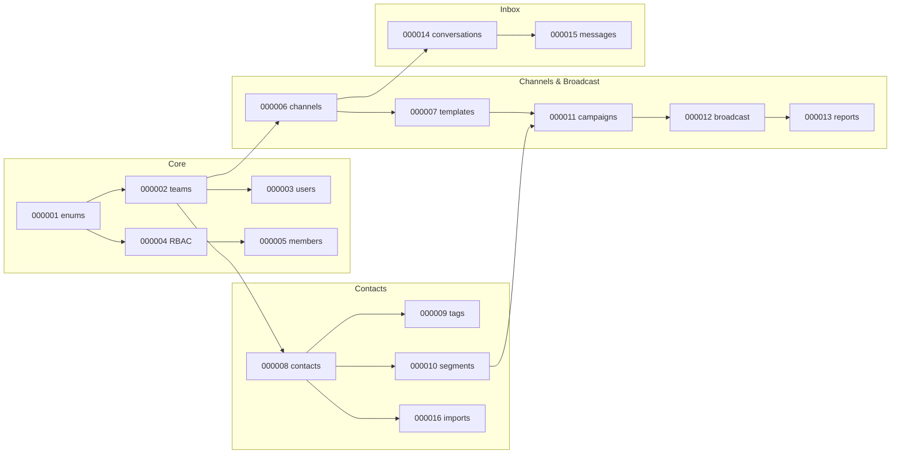

# Phase 9A Review — PostgreSQL Migration Design & Generation

**Status:** Awaiting audit  
**Date:** 2026-06-22  
**Scope:** Schema migrations only (no Go repositories/handlers)

---

## 1. Executive summary

Phase 9A delivers **16 ordered PostgreSQL migrations** (`000001`–`000016`) implementing the Omni-Chan v1 schema aligned with:

| Source document | Path |
|-----------------|------|
| API Contract v1 | `docs/api-v1-contract.md` |
| Database Design v1 | `docs/database-schema-v1.md` |
| Broadcast Execution Architecture | `docs/broadcast-execution-architecture.md` |
| Migration plan | `docs/migration-plan-v1.md` |

**Deliverables produced:**

- 32 SQL files (16 × `.up.sql` + `.down.sql`)
- RBAC seed data (4 roles, 42 permissions)
- Partition-ready tables for high-volume data
- Recipient status monotonic trigger (webhook idempotency)
- Legacy pre-v1 migrations archived (not in migrate path)
- `migrate-force` CLI support for dirty-state recovery

**Install model:** Greenfield database only. Legacy DB upgrade is **out of scope** for 9A (deferred to Phase 9B ETL).

---

## 2. Audit scope

### In scope

| Item | Status |
|------|--------|
| Table inventory (31 tables) | Delivered |
| Enum types (25+) | Delivered |
| Indexes (btree, partial, GIN trigram) | Delivered |
| Unique constraints (partial) | Delivered |
| Soft delete columns | Delivered |
| Broadcast execution tables | Delivered |
| RBAC seeds | Delivered |
| Down migrations | Delivered |
| Migration ordering / FK dependencies | Delivered |

### Out of scope (by design)

| Item | Phase |
|------|-------|
| Go repositories | 9B |
| API handlers | Later |
| Partition auto-management jobs | Post-9A |
| Legacy `devices` → `channels` data ETL | 9B |
| Automated migration CI test | Recommended pre-prod |

---

## 3. Migration inventory

| Ver | File | Tables / objects created |
|-----|------|--------------------------|
| 000001 | `extensions_and_enums` | `pg_trgm`, `pgcrypto`, 25 enum types |
| 000002 | `teams_workspace` | `teams`, `workspace_readiness_snapshots` |
| 000003 | `users` | `users`, `refresh_tokens`, `teams.owner_id` FK |
| 000004 | `roles_permissions` | `roles`, `permissions`, `role_permissions` + seeds |
| 000005 | `team_members` | `team_members`, `team_invitations` |
| 000006 | `channels` | `channels`, `channel_credentials`, `channel_onboarding` |
| 000007 | `templates` | `templates` |
| 000008 | `contacts` | `contacts` |
| 000009 | `tags` | `tags`, `contact_tags` |
| 000010 | `segments` | `segments`, `segment_rules`, `segment_members` |
| 000011 | `campaigns` | `campaigns`, `campaign_audiences` |
| 000012 | `broadcast_execution` | `broadcast_jobs`, `broadcast_batches`, `campaign_audience_snapshots`, `campaign_recipients` (partitioned), status trigger |
| 000013 | `reports` | `campaign_link_clicks`, `campaign_daily_stats` |
| 000014 | `conversations` | `conversations` |
| 000015 | `messages` | `messages` (partitioned) |
| 000016 | `import_jobs` | `contact_import_jobs`, `contact_import_files`, `contact_import_rows` (partitioned), `contacts.import_job_id` FK |

**Path:** `services/backend-service/migrations/`  
**Archived (inactive):** `migrations/archive/legacy-pre-v1/` (11 legacy pairs)

---

## 4. Alignment checklist

### 4.1 vs API Contract v1

| API concept | Schema mapping | Audit |
|-------------|----------------|-------|
| `workspace_id` | `teams.id` | PASS |
| `channel_id` | `channels.id` | PASS |
| `ChannelDTO.name` | `channels.name` | PASS |
| `TemplateDTO.components` | `templates.components` JSONB | PASS |
| `CampaignDTO` counters | `campaigns.sent_count`, etc. | PASS |
| `marketing_status` | `contacts.marketing_status` enum | PASS |
| `recipient_status` (9 states) | `recipient_status` enum | PASS |
| RBAC permission codes | `permissions.code` seeds | PASS |
| `channel.view` / `channel.manage` | Seeded + `device.*` aliases | PASS |

### 4.2 vs Database Design v1

| Design item | Migration | Audit |
|-------------|-----------|-------|
| 31 required tables | All present | PASS |
| UUID PKs | All tables | PASS |
| `TIMESTAMPTZ` | All timestamps | PASS |
| Soft delete | teams, users, channels, templates, campaigns, contacts, tags, segments, conversations | PASS |
| `plan_type` + limits | `teams` | PASS |
| Materialized segments | `segment_members` | PASS |
| Campaign reporting | `campaign_daily_stats`, `campaign_link_clicks` | PASS |

### 4.3 vs Broadcast Execution Architecture

| Architecture item | Migration | Audit |
|-------------------|-----------|-------|
| `broadcast_jobs` | 000012 | PASS |
| `broadcast_batches` | 000012 | PASS |
| `campaign_audience_snapshots` | 000012 | PASS |
| `campaign_recipients` + `job_id`, `batch_id` | 000012 | PASS |
| Monotonic status trigger | `enforce_recipient_status_monotonic()` | PASS |
| `wamid` unique index | recipients + messages | PASS |
| Partition-ready recipients | `RANGE (created_at)` + DEFAULT | PASS |

---

## 5. Schema highlights for auditors

### 5.1 Tenant isolation

All business tables include `team_id` FK to `teams` (directly or via parent entity).

### 5.2 Scale-oriented design

| Table | Strategy |
|-------|----------|
| `campaign_recipients` | Partitioned by `created_at`; unique `(campaign_id, contact_id, created_at)` |
| `messages` | Partitioned by `created_at` |
| `contact_import_rows` | Partitioned by `created_at` |
| `contacts` | GIN trigram on name, phone, email; partial unique `(team_id, phone)` |

### 5.3 Security

| Item | Implementation |
|------|----------------|
| Channel tokens | `channel_credentials.access_token_enc` BYTEA (separate table) |
| Refresh tokens | `refresh_tokens.token_hash` (not plaintext) |

### 5.4 Data integrity

| Rule | Enforcement |
|------|-------------|
| One contact per phone per team | Partial unique index |
| One active broadcast job per campaign | Partial unique on `broadcast_jobs` |
| Recipient status progression | `BEFORE UPDATE` trigger on `campaign_recipients` |
| Meta webhook dedupe | Unique `(wamid, created_at)` where not null |

---

## 6. Issues discovered during implementation

| # | Issue | Root cause | Fix applied | Audit status |
|---|-------|------------|-------------|--------------|
| 1 | Version conflict `000001`–`000011` | New v1 migrations reused legacy version numbers | Legacy moved to `archive/legacy-pre-v1/` | RESOLVED |
| 2 | `channel_type` type not found | Column name shadowed enum name `channel_type` | Renamed enum → `conversation_channel_type` | RESOLVED |
| 3 | `VALUES lists must all be the same length` | `device.manage` row missing `name` column | Added `'Manage Devices'` | RESOLVED |
| 4 | Dirty migration at v14 | Partial failure + `force` without clean schema | Added `migrate-force`; idempotent 000014–000016 | RESOLVED |
| 5 | `channels` does not exist on legacy DB | v1 migrations on legacy schema | Documented: **greenfield DB required** | DOCUMENTED |
| 6 | `conversations` already exists | `CREATE TABLE IF NOT EXISTS` + legacy `device_id` | Legacy upgrade block in 000014 | WORKAROUND |

---

## 7. Open findings (audit action items)

| # | Severity | Finding | Recommendation |
|---|----------|---------|----------------|
| F1 | **High** | No automated greenfield migration test in CI | Add `scripts/test-migrations.sh` + Docker Postgres in CI |
| F2 | **Medium** | `000014`/`000015` contain legacy compatibility blocks | Remove legacy blocks after greenfield-only policy confirmed |
| F3 | **Medium** | `campaign_link_clicks.recipient_id` has no FK | Accept for v1 or add FK in 9B (partition complexity) |
| F4 | **Medium** | Partition management not implemented | Schedule monthly partition job before production scale |
| F5 | **Low** | `000012.down.sql` drops `fk_contacts_import_job_id` (owned by 000016) | Harmless (`IF EXISTS`); cosmetic reorder optional |
| F6 | **Low** | `growth` plan limit (100k) not in original 50k/300k brief | Confirm product tiers or align to 50k/300k only |
| F7 | **Info** | Runtime `migrate-up` not verified in agent environment | Auditor must run on PostgreSQL 16+ |

---

## 8. Fresh database verification procedure

Auditor should execute on **empty** database:

```bash
# 1. Create empty database
dropdb omni_chan_dev --if-exists
createdb omni_chan_dev -O omnichan

# 2. Run migrations
cd services/backend-service
make migrate-up

# 3. Verify version
psql "$DATABASE_URL" -c "SELECT version, dirty FROM schema_migrations;"
# Expected: version=16, dirty=false

# 4. Verify core tables
psql "$DATABASE_URL" -c "\dt" | grep -E "channels|campaigns|broadcast_jobs|campaign_recipients|conversations|messages"

# 5. Verify RBAC seeds
psql "$DATABASE_URL" -c "SELECT COUNT(*) FROM roles;"      # 4
psql "$DATABASE_URL" -c "SELECT COUNT(*) FROM permissions;" # 42

# 6. Verify enums
psql "$DATABASE_URL" -c "SELECT typname FROM pg_type WHERE typtype='e' ORDER BY 1;"

# 7. Rollback smoke test (optional)
make migrate-down   # repeats 16 times to version 0
make migrate-up     # full re-apply
```

**Do not use `migrate-force` on a clean install.**

---

## 9. Down migration audit

| Check | Result |
|-------|--------|
| Each `.up.sql` has matching `.down.sql` | PASS (16 pairs) |
| Down order reverses FK dependencies | PASS (016 → 001) |
| `DROP TYPE` in 000001.down requires empty tables | PASS (only safe after full down chain) |
| Partitioned tables dropped via parent | PASS (`DROP TABLE campaign_recipients` cascades) |
| Trigger/function cleanup in 000012.down | PASS |

**Note:** Full `migrate-down` from 16 → 0 is destructive and intended for dev only.

---

## 10. Tooling changes (Phase 9A)

| File | Change |
|------|--------|
| `pkg/migrate/migrate.go` | Added `Force(version)` |
| `cmd/migrate/main.go` | Added `-direction=force -version=N` |
| `Makefile` | Added `migrate-force VERSION=N` |

---

## 11. Dependency graph



---

## 12. Auditor sign-off template

| Criterion | Pass | Fail | Notes |
|-----------|------|------|-------|
| All 31 tables created on fresh `migrate-up` | ☐ | ☐ | |
| `schema_migrations.version = 16`, `dirty = false` | ☐ | ☐ | |
| RBAC seeds correct (4 roles, 42 permissions) | ☐ | ☐ | |
| Partitioned tables + DEFAULT partitions exist | ☐ | ☐ | |
| Recipient status trigger present | ☐ | ☐ | |
| Aligns with API v1 contract | ☐ | ☐ | |
| Aligns with database design v1 | ☐ | ☐ | |
| Aligns with broadcast architecture | ☐ | ☐ | |
| Legacy upgrade path documented | ☐ | ☐ | |
| Ready for Phase 9B repositories | ☐ | ☐ | |

**Auditor name:** _______________  
**Date:** _______________  
**Decision:** ☐ Approved  ☐ Approved with conditions  ☐ Rejected  

**Conditions (if any):**

---

## 13. Recommendation

| Decision | Rationale |
|----------|-----------|
| **Approve for Phase 9B** | Schema complete, aligned with approved designs, blockers fixed |
| **Condition:** Run fresh DB verification (§8) before repository work | Confirms runtime apply on PostgreSQL 16+ |
| **Condition:** Add CI migration test (F1) | Prevents regression like `device.manage` row error |
| **Defer:** Legacy DB ETL | Separate track; do not patch migrations further |

---

## 14. Related files

```
docs/api-v1-contract.md
docs/database-schema-v1.md
docs/broadcast-execution-architecture.md
docs/migration-plan-v1.md
services/backend-service/migrations/000001_*.sql … 000016_*.sql
services/backend-service/migrations/archive/legacy-pre-v1/
services/backend-service/Makefile
services/backend-service/pkg/migrate/migrate.go
```

---

*Phase 9A review document — for audit before Phase 9B Repository Layer.*
