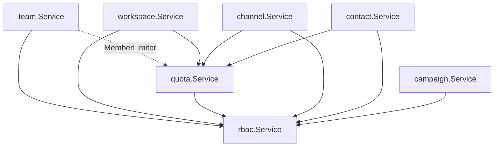

# Phase 9C — Service Layer

**Status:** Ready for review  
**Scope:** Business logic services only (no HTTP handlers, REST routes, NATS workers)

---

## 1. Objective

Implement the service layer between repositories and future HTTP handlers, aligned with:

- Phase 9B repositories (`docs/phase-9b-repository-layer.md`)
- API v1 contract (`docs/api-v1-contract.md`)
- Broadcast execution architecture (`docs/broadcast-execution-architecture.md`)

```
Handler → Service → Repository → PostgreSQL
              ↑
         RBAC + Quotas
```

---

## 2. Service Inventory

| Spec name | Package | Type | Primary dependencies |
|-----------|---------|------|----------------------|
| `WorkspaceService` | `internal/workspace` | `*workspace.Service` | `team.Repository`, `quota.Service`, `rbac.Service` |
| `TeamService` | `internal/team` | `*team.Service` | `team.Repository`, `user.Repository`, `MemberLimiter`, `rbac.Service` |
| `ChannelService` | `internal/channel` | `*channel.Service` | `channel.Repository`, `team.Repository`, `quota.Service`, `rbac.Service` |
| `TemplateService` | `internal/template` | `*template.Service` | `template.Repository`, `channel.Repository`, `team.Repository`, `rbac.Service` |
| `ContactService` | `internal/contact` | `*contact.Service` | `contact.Repository`, `team.Repository`, `workspace.Service`, `rbac.Service` |
| `SegmentService` | `internal/segment` | `*segment.Service` | `segment.Repository`, `team.Repository`, `rbac.Service` |
| `CampaignService` | `internal/campaign` | `*campaign.Service` | `campaign.Repository`, `channel.Repository`, `template.Repository`, `segment.Repository`, `team.Repository`, `rbac.Service` |
| `ReportService` | `internal/report` | `*report.Service` | `report.Repository`, `team.Repository`, `rbac.Service` |
| `ConversationService` | `internal/conversation` | `*conversation.Service` | `conversation.Repository`, `contact.Repository`, `team.Repository`, `rbac.Service` |
| `MessageService` | `internal/message` | `*message.Service` | `message.Repository`, `conversation.Repository`, `team.Repository`, `rbac.Service` |
| `ImportService` | `internal/importjob` | `*importjob.Service` | `importjob.Repository`, `team.Repository`, `workspace.Service`, `rbac.Service` |

**Shared:**

| Path | Purpose |
|------|---------|
| `pkg/serviceerrors` | Canonical service errors + `MapRepository` |
| `pkg/slug` | Workspace slug generation |
| `pkg/planlimits` | Plan-based member limits |
| `internal/quota` | Contact/channel/member quota enforcement |

---

## 3. Dependency Graph



**Construction order (DI):**

1. Repositories + `rbac.Service`
2. `quota.NewService(teams, channelRepo, contactRepo)`
3. `workspace.NewService(teams, quota, rbac)`
4. `team.NewService(teams, users, quota, rbac)` — `quota.Service` satisfies `team.MemberLimiter`
5. Channel, template, contact, segment services
6. `campaign.NewService(campaigns, teams, channelRepo, templateRepo, segmentRepo, rbac)`

---

## 4. Error Strategy

### 4.1 Layer mapping

```
repository.ErrNotFound  → serviceerrors.ErrNotFound   → HTTP 404 (future)
repository.ErrConflict  → serviceerrors.ErrConflict   → HTTP 409
repository.ErrLimitExceeded → serviceerrors.ErrQuotaExceeded → HTTP 402/403
ValidationError         → serviceerrors.ErrValidation → HTTP 400
serviceerrors.ErrForbidden → HTTP 403
```

### 4.2 Package-local errors

`internal/team` retains legacy errors (`ErrForbidden`, `ErrAlreadyMember`, etc.) for backward compatibility with existing handlers. New modules use `pkg/serviceerrors` exclusively.

---

## 5. Transaction Boundaries

| Operation | Transaction owner | Notes |
|-----------|-------------------|-------|
| Campaign create + draft job + snapshot | Service orchestration | Roll back campaign via `SoftDelete` if job/snapshot insert fails |
| Contact import job + file | Service (sequential calls) | File optional on create |
| Segment create + rules | Repository `WithTx` | Transparent to service |
| Campaign create + audiences | Repository `WithTx` | Transparent to service |
| Report link click + daily stat | Service (2 calls) | Idempotent increment via `ON CONFLICT` |

Cross-repository atomicity (e.g. campaign + contact updates) deferred to Phase 10 `UnitOfWork`.

---

## 6. Validation Rules

### WorkspaceService
- Name, timezone, country (ISO 3166-1 alpha-2) on update
- Quota helpers: `AssertContactHeadroom`, `AssertChannelHeadroom`, `AssertMemberHeadroom`

### TeamService
- Assignable roles: admin, supervisor, agent (not owner)
- Cannot modify owner member
- Member limit by plan: starter=5, growth=25, business=100, enterprise=unlimited

### ChannelService
- Channel quota before create
- `ValidateForCampaign`: status=`connected`, onboarding=`completed`

### TemplateService
- `ValidateForCampaign`: approved status, same channel as campaign

### ContactService
- E.164 phone format
- Duplicate phone per team → conflict
- `marketing_status`: subscribed | unsubscribed | unknown
- Contact quota before create

### SegmentService
- At least one rule on create
- Valid rule field/operator enums

### CampaignService
- Channel exists + campaign-ready
- Template approved + channel match
- Segment exists (if provided)
- Audience sources required (segment and/or explicit sources)
- `send_mode`: `now` | `later`; `scheduled_at` required and future for `later`
- Creates: campaign (draft) + `broadcast_jobs` (pending) + `campaign_audience_snapshots`

### ImportService
- Contact headroom vs `total_rows` before job create
- Valid import source enum

### ConversationService / MessageService
- Team membership on all operations
- Assignee must be team member
- Message content and sender required

### ReportService
- Date range `from` ≤ `to`

---

## 7. Permission Checks

Services accept `actorRole string` from JWT (future handler layer). RBAC via `rbac.Service.Require(role, permission)`.

| Service | Permissions used |
|---------|------------------|
| Workspace | `user.view`, `workspace.manage` |
| Team | `user.*`, `workspace.manage` |
| Channel | `device.view`, `device.manage` |
| Template | `template.view`, `template.sync` |
| Contact / Segment / Import | `contact.*` |
| Campaign | `campaign.view`, `campaign.create` |
| Report | `report.view` |
| Conversation | `conversation.view`, `conversation.assign`, `conversation.reply` |
| Message | `conversation.view`, `conversation.reply` |

---

## 8. Unit Test Strategy

| Package | Tests | Coverage |
|---------|-------|----------|
| `pkg/serviceerrors` | Error mapping, validation type | Implemented |
| `internal/campaign` | `validateSendMode`, `validateAudienceSource` | Implemented |
| `internal/team` | Permission + forbidden paths | Existing |
| Future | Mock repositories for Create flows | Phase 9D |

Integration tests with real DB recommended in Phase 9D alongside handler wiring.

---

## 9. Out of Scope (Phase 9C)

- HTTP handlers / Fiber routes
- `cmd/api/main.go` DI rewiring (existing legacy handlers unchanged)
- NATS workers / campaign send execution
- Meta API template sync implementation
- WebSocket realtime push

**Note:** `cmd/api/main.go` still references legacy service constructors. Handler rewiring is Phase 10.

---

## 10. Review Checklist

- [ ] All 11 services implemented
- [ ] No SQL in services
- [ ] Repository errors mapped via `serviceerrors.MapRepository`
- [ ] RBAC checks on mutating operations
- [ ] Quota checks (contact, channel, member)
- [ ] Campaign create produces draft job + audience snapshot
- [ ] Channel/template/segment validation in CampaignService
- [ ] Dependency graph documented
- [ ] No handlers or workers added

---

## 11. Next Phase (10 suggestion)

1. Wire services in `cmd/api/main.go`
2. Replace legacy handlers with API v1 handlers
3. Apply RBAC middleware per route
4. Campaign send worker uses `CampaignService` + repositories
