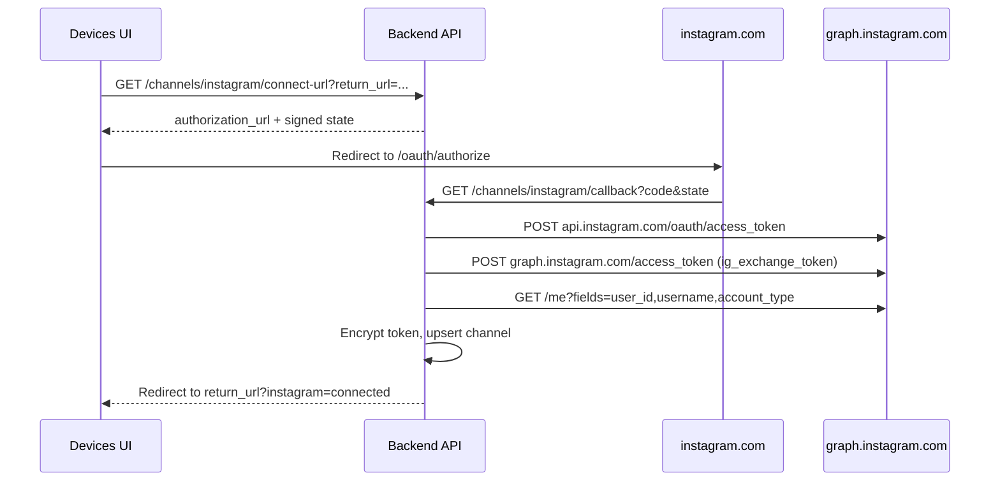

# Instagram Business Login — Implementation Review

## Summary

Replaced the previous **Facebook Login + Page lookup** Instagram onboarding path with the official **Instagram API with Instagram Login** flow (`https://www.instagram.com/oauth/authorize`).

WhatsApp Embedded Signup, inbox, contacts, and webhooks were not modified.

## Modified files

| File | Change |
|------|--------|
| `services/backend-service/pkg/meta/instagram_oauth.go` | Instagram Login authorize URL, code exchange, long-lived token exchange, profile lookup, account-type validation |
| `services/backend-service/pkg/meta/instagram_oauth_test.go` | Unit tests for authorize URL, validation, profile fetch |
| `services/backend-service/internal/config/config.go` | `INSTAGRAM_APP_ID`, `INSTAGRAM_APP_SECRET`, `INSTAGRAM_REDIRECT_URI` |
| `services/backend-service/internal/instagram/oauth_service.go` | Business Login connect/callback/status/disconnect service |
| `services/backend-service/internal/instagram/oauth_service_test.go` | Service tests |
| `services/backend-service/internal/api/v1/handler/instagram_oauth.go` | HTTP handlers |
| `services/backend-service/internal/api/v1/routes.go` | New routes; public callback |
| `services/backend-service/internal/meta/health_service.go` | Instagram token + profile health |
| `services/backend-service/internal/meta/health_service_test.go` | Constructor signature |
| `services/backend-service/internal/meta/client.go` | Removed unused Facebook Instagram helpers |
| `services/backend-service/cmd/api/main.go` | Wire Instagram config + health client |
| `services/backend-service/.env.example` | Instagram env vars |
| `docs/openapi/v1.yaml` | connect-url, callback, status |
| `frontend/src/features/channels/services/instagram-oauth.service.ts` | Frontend API client |
| `frontend/src/features/devices/components/devices-page.tsx` | Connect button + return URL handling |

## OAuth flow



## Token flow

1. **Authorize** — `https://www.instagram.com/oauth/authorize` with scopes:
   - `instagram_business_basic`
   - `instagram_business_manage_messages`
   - `instagram_business_manage_comments`
   - `instagram_business_content_publish`
2. **Short-lived token** — `POST https://api.instagram.com/oauth/access_token`
3. **Long-lived token** — `POST https://graph.instagram.com/access_token` (`grant_type=ig_exchange_token`)
4. **Storage** — encrypted in `channel_credentials.access_token_enc`; expiry in `token_expires_at`
5. **Channel** — `provider=instagram`, `channel_type=instagram`, `ig_user_id`, username in `name`, `account_type` in `health_metadata`

Personal accounts (`account_type=PERSONAL`) are rejected with `validation_error`.

## API

| Method | Path | Auth | Purpose |
|--------|------|------|---------|
| GET | `/api/v1/channels/instagram/connect-url` | JWT | Returns Instagram authorize URL |
| GET | `/api/v1/channels/instagram/callback` | Public (state HMAC) | OAuth callback |
| GET | `/api/v1/channels/instagram/status` | JWT | Connection status |
| DELETE | `/api/v1/channels/instagram/connection` | JWT | Disconnect (unchanged helper) |

## Health check

`GET /api/v1/channels/{id}/health` for Instagram channels verifies:

- Token not expired (`channel_credentials.token_expires_at`)
- `GET graph.instagram.com/me` succeeds

Returns `healthy=false` when the token is expired or the profile call fails.

## Security review

- OAuth `state` is HMAC-signed with `INSTAGRAM_APP_SECRET` and includes team/user IDs + expiry.
- Callback is public but cannot bind a code to a workspace without valid state.
- Access tokens are encrypted at rest; never logged or returned by API.
- `return_url` is optional and only used for browser redirect after callback.
- Instagram app credentials are separate from WhatsApp/Meta Embedded Signup credentials.

## Regression check — WhatsApp Embedded Signup

Confirmed untouched:

- `embedded-signup/*` routes and handlers
- `META_EMBEDDED_CONFIG_ID`, Embedded Signup services
- WhatsApp channel creation/sync/webhook paths
- Inbox, contacts, conversations, message send/receive

## Environment

```env
INSTAGRAM_APP_ID=
INSTAGRAM_APP_SECRET=
INSTAGRAM_REDIRECT_URI=https://<api-host>/api/v1/channels/instagram/callback
```

Register the redirect URI exactly in Meta App → Instagram → Business login settings.

## Out of scope (unchanged)

- Instagram webhooks
- Instagram send/receive messaging
- Contact merge
- Inbox routing for Instagram conversations
